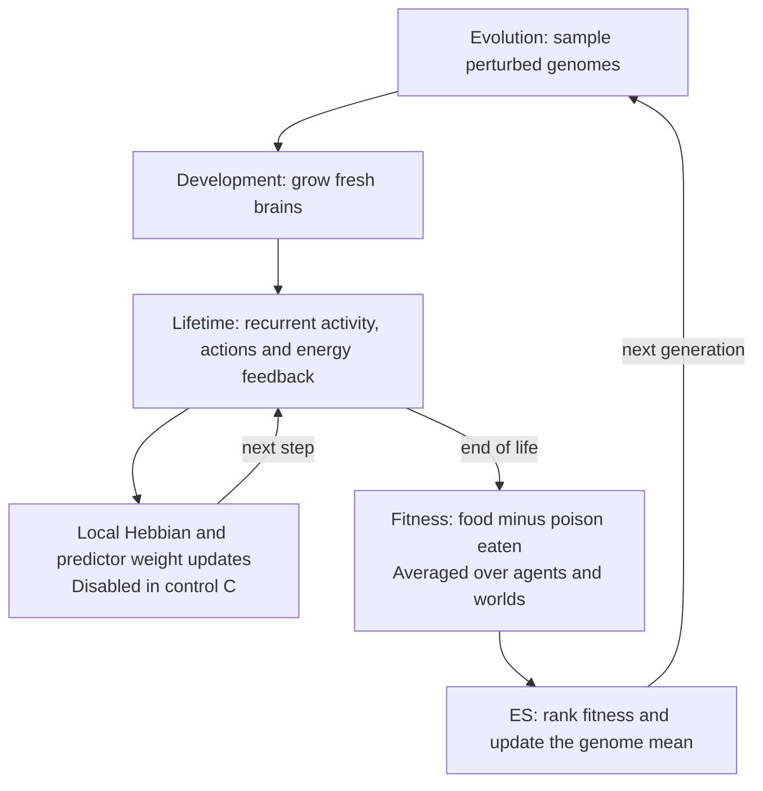
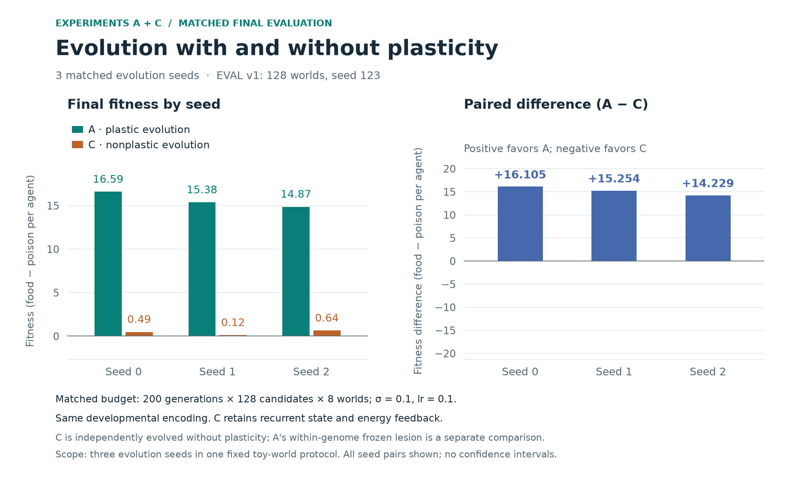
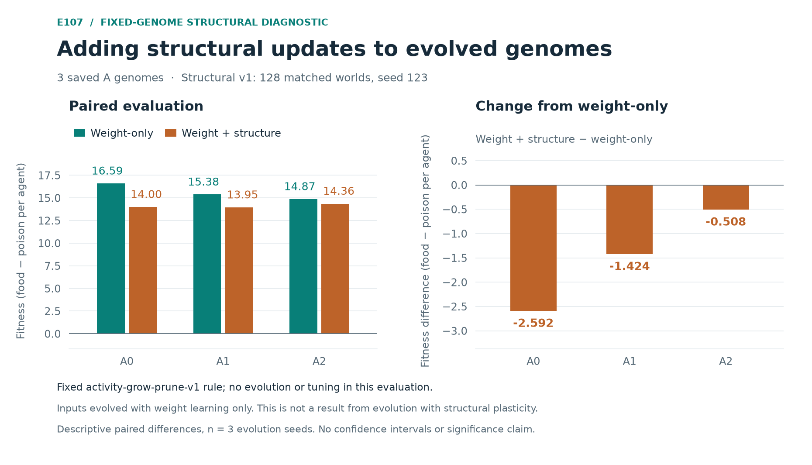
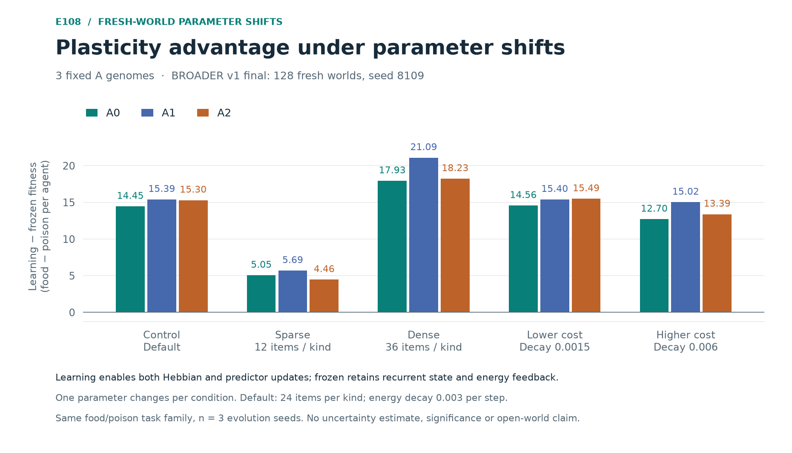

# Seed

**Evolve the rules. Grow a brain. Learn during a life.**

Can evolution discover rules that let a new brain learn from experience? Seed explores that question in a small, inspectable JAX simulation. A genome of **155 numbers** specifies how a recurrent brain grows and how its connections change. Its agents forage in worlds where the same kind of object can be food in one world and poison in another. Lifetime learning uses local updates, without labelled examples or backpropagation.

**Phase 2 result · 19 Nov 2026: the nonplastic baseline wins on the registered score in all three seeds. The continuation gate FAILED.** Direct-controller fitness is **55.520 ± 3.899, 66.481 ± 4.533 and 69.869 ± 4.757 SE**, versus plastic A **15.346 ± 0.377, 15.187 ± 0.385 and 14.984 ± 0.351** on 256 matched held-out worlds. Each direct advantage exceeds two paired SE. High scores nevertheless conceal one-rule specialization and poor reversal survival. [Full comparison and artifacts](results/E113_BASELINE.md).

**Latest diagnostic · E114:** all 11 saved-controller/reference panels passed their measurement-validity audit on 256 fresh paired worlds. For each starting individual, take the worse of its two stationary-rule returns, then average. A0/A1/A2 score **8.237 ± 0.302, 8.453 ± 0.310 and 8.396 ± 0.297 SE**; direct0/1/2 score **−3.992 ± 0.003, −3.978 ± 0.008 and −3.962 ± 0.013**. Joint survival under both rules is **71.00 ± 1.41%, 70.51 ± 1.42%, 73.24 ± 1.43%** for A, versus **0%, 0.10 ± 0.10%, 0.10 ± 0.10%** for direct. [Full EVAL v4 measurements and artifacts](results/EVAL_V4.md).

The mixed-specialist reference scores **33.486 ± 1.236 SE** on mean fitness but **−3.970 ± 0.008** on individual paired minimum, with zero joint survivors. Thus even success averaged across both rules can conceal different individuals failing. These are fresh matched lives, not memory carried between lives; privileged greedy succeeds without learning. A's post-reversal returns remain **−2.812 ± 0.083, −2.567 ± 0.089 and −2.597 ± 0.095**, so recovery remains weak. This measurement does not change E113's failed gate or establish a causal learning mechanism.

**Current work:** under the owner's delegated authority, the council preregistered E115: six matched continuations of the existing plastic models, comparing mean-return selection with selection on each individual's lower return across the two rules. Both arms get identical exposure; improvement must exceed both the other arm and the unchanged start in all three seeds, without a clear joint-survival regression. Implementation passed all 156 tests locally and in hosted CI. Four of six continuations finished all fifty generations and passed their artifact audits; both A0 and A1 pairs have matching starts and random-stream positions. Held-out evaluation remains deferred. A conservative full-study forecast exceeded the original four-hour allowance, so the council prospectively approved five hours under the owner delegation, keeping all scientific settings and the daily eight-hour limit. No held-out E115 result exists yet. E114 passed all **133 local tests**; its hosted repeat stopped at the approved verification budget after 88 tests passed and is **incomplete**, not a completed pass.

**Working directive:** learn from experience, adapt when conditions change, and retain what remains useful. This is the research aim, not a capability already demonstrated or a new reward function. The registered task ladder tests each part before adding mechanisms.

**Earlier measurement · E112:** among the same agents reaching meal 20, A0/A1/A2 improve first-to-twentieth-meal accuracy by **26.82 ± 2.42, 21.14 ± 2.44 and 24.87 ± 2.24 percentage points (SE)**. This is conditional on reaching meal 20. Stationary fitness is only **18.2–18.7%** of the local rule-knowing reference; reversal fitness is **4.5–5.2%**. Current lifetime learning changes weights; active connection growth is off because the earlier tested rule reduced fitness in all three saved A genomes.


*Historical final A genomes on fixed EVAL v1: 128 worlds, evaluation seed 123. Each enabled/frozen pair uses the same genome; accuracy gains pool eating events. This lesion comparison is distinct from the independently evolved E113 baseline above.*

## Phase 1: learning is measurable; reversal remains weak

| Saved genome | Stationary fitness ± SE | Reversal fitness ± SE |
|---|---:|---:|
| A0 | 15.346 ± 0.377 | 3.127 ± 0.183 |
| A1 | 15.187 ± 0.385 | 3.529 ± 0.183 |
| A2 | 14.984 ± 0.351 | 3.576 ± 0.166 |
| B0 | 14.970 ± 0.376 | 3.161 ± 0.173 |
| biology | 5.793 ± 0.266 | 1.179 ± 0.154 |
| blank0 | 0.080 ± 0.139 | -0.015 ± 0.127 |
| blank1 | 0.597 ± 0.155 | 0.161 ± 0.136 |
| blank2 | 0.257 ± 0.139 | 0.058 ± 0.130 |
| random_walk | -0.093 ± 0.128 | 0.011 ± 0.120 |
| greedy | 82.278 ± 1.364 | 69.024 ± 0.700 |

Each SE uses 256 world-families as independent units; it is not variation across evolution seeds. B0 is descriptive, not a three-seed B claim. Greedy knows the current rule but sees only the local patch; it is a reference rather than an optimal bound. Worlds, random streams and policies match across panels. Full meal curves, eligible-agent counts, survivor bins, post-reversal bins and raw artifact links are in [EVAL_V3.md](results/EVAL_V3.md).

- Asked: measure learning and reversal fairly on fresh worlds, with uncertainty and reference policies.
- Happened: all eight panels completed; A fitness is 14.984–15.346 (SE 0.351–0.385) stationary and 3.127–3.576 (SE 0.166–0.183) with reversal. Final post-reversal accuracy is 46.2%, 49.3%, 48.1% (SE 1.4, 1.2, 1.3 percentage points).
- Means: within-cohort learning appears in all three evolved A genomes; recovery after change remains weak.
- Does not mean: robust transfer, useful connection growth, a wiring-prior advantage or superiority to a fairly trained nonplastic controller has been established. Meal and survivor curves are selection-conditioned.
- Next at Phase 1 closure: Phase 2's matched-budget nonplastic recurrent baseline; now completed below.

## Phase 2: baseline wins, objective rewards specialization

E113 completed three directly encoded recurrent controllers under A's ES settings and 200-generation budget. Their 8,424 inherited weights stay fixed during a life, while recurrent state can still adapt to observations and feedback. This replaces the historical tied-sensor C baseline. The implementation passed 112 tests locally and in hosted CI; all three runs passed their final artifact audits.

| Seed | Plastic A fitness ± SE | Direct fitness ± SE | Paired A − direct ± SE | Direct reversal fitness ± SE |
|---|---:|---:|---:|---:|
| 0 | 15.346 ± 0.377 | 55.520 ± 3.899 | −40.174 ± 3.922 | 14.016 ± 1.218 |
| 1 | 15.187 ± 0.385 | 66.481 ± 4.533 | −51.295 ± 4.544 | 16.557 ± 1.388 |
| 2 | 14.984 ± 0.351 | 69.869 ± 4.757 | −54.885 ± 4.737 | 19.071 ± 1.536 |

Each SE describes 256 world-families for a fixed trained genome, not variation across training seeds. The registered continuation rule required A − direct > 2 paired SE in **all three** seeds. It passed in **zero of three**; the baseline has a clear advantage on this score in all three. Reversal is secondary and cannot replace the primary gate.

A descriptive inspection of seed 0 exposes an objective limitation: fitness is **115.027 ± 2.301 SE** under one initial rule and **−3.988 ± 0.005** under the other. All agents survive the favorable stationary rule; none survive the opposite rule or reversal. Food continues adding fitness at the energy cap, while death stops further losses. A persistent blob preference can therefore score highly without reliable rule adaptation. These post-result diagnostics do not change the registered gate or justify changing the score mid-comparison.

Seeds 1 and 2 favor the opposite initial rule: **136.938 ± 2.088** and **143.676 ± 2.258 SE** in their favorable rule, versus **−3.975 ± 0.008** and **−3.938 ± 0.032** in the other. Favorable stationary survival is 99.8–100%; unfavorable survival is 0–0.4%. Overall final reversal survival is 0%, 0.29% and 0.29%. These descriptive, post-result strata expose the scoring concern; positive mean reversal fitness does not establish recovery or identify the controller's internal mechanism.

The [paper review and council decisions](experiments/LITERATURE_REVIEW.md) distinguish evidence for biological mechanisms from evidence that their implementations help Seed. The workflow is a literature proposal, skeptical review, one preregistered comparison, guarded compute, then review of the results. Candidate weight decay and eligibility traces remain conditional on the task ladder's specified failures. Growth/pruning is measured separately from weight learning; the failed rule is not silently re-enabled.

The direct baseline changes representation, density, developmental variation and weight bounds as well as lifetime plasticity. Equal ES settings do not make an 8,424-parameter search as easy as a 155-parameter search. This is a comparison of these designs under the registered budget, not an isolated causal test of plasticity. Original EVAL v1 and all earlier run artifacts remain intact.

- Asked: compare plastic agents with a directly encoded recurrent baseline under the same evolution budget, in three seeds.
- Happened: direct fitness was 55.520 ± 3.899, 66.481 ± 4.533 and 69.869 ± 4.757 SE; all three paired comparisons favored it, so Phase 2's continuation gate failed.
- Means: the baseline wins the registered objective, and rule-specific outcomes reveal that this objective can reward specialization instead of reliable adaptation.
- Does not mean: the baseline learns the hidden rule, plasticity has no value, or useful new connections or broad transfer have been demonstrated.
- Next at gate closure: owner input. The owner subsequently approved [E114, a diagnostic of individual adaptation versus specialist mixtures](experiments/E114_PROPOSAL.md); implementation is underway, and it does not change E113's failed gate.

## Three loops, one experiment

| Loop | What happens |
|---|---|
| **Evolution · across generations** | Evolution strategies search for genomes whose agents eat more food than poison. |
| **Development · at birth** | Each genome grows a brain from wiring rules; related agents share a genome but have different random wiring. |
| **Learning · during life** | Local Hebbian and prediction updates change the brain using its experience, including energy change and prediction error. |



Evolution changes the genome between generations; lifetime weight changes are not inherited. Historical control C kept recurrent state and energy feedback active while disabling local weight updates, but its tied sensor encoding restricted it. E113 replaces C for later claims by giving the fixed-weight baseline independent sensor-channel weights.

The current world is a 16 × 16 wrapping grid. Four related agents live for up to 300 steps, seeing only a local patch. Each world has a hidden rule assigning its two object types to food or poison. This makes a compact test bed for studying the interaction of evolution, development and plasticity.

## Try a small run

Open a terminal in the root of your local Seed checkout; cloning this private repository requires access. Start with a clean Git checkout and no other Seed job running. The verified environment is **Python 3.12.10 with JAX on CPU, on Windows**. `requirements.txt` pins its installed package versions, including JAX and jaxlib 0.12.0.1. The macOS/Linux commands are provided for setup but have not been exercised here.

**Windows · PowerShell**

```powershell
python -m venv .venv
.\.venv\Scripts\python.exe -m pip install --no-cache-dir -r requirements.txt
.\.venv\Scripts\python.exe scripts/run_experiment.py --name smoke --quick
.\.venv\Scripts\python.exe -X utf8 scripts/summarize.py
```

**macOS or Linux**

```bash
python3 -m venv .venv
.venv/bin/python -m pip install --no-cache-dir -r requirements.txt
.venv/bin/python scripts/run_experiment.py --name smoke --quick
.venv/bin/python scripts/summarize.py
```

<details>
<summary>Owner's Windows laptop: keep setup temporary files on D:</summary>

Use a checkout on D: and run these PowerShell commands before setup:

```powershell
New-Item -ItemType Directory -Force .tmp | Out-Null
$env:TEMP = $env:TMP = (Resolve-Path .tmp).Path
$env:PYTHONUTF8 = '1'
```

</details>

Open the new folder under `runs/`: `config.json` records the settings and source commit, `metrics.jsonl` records training progress, and `summary.json` contains the evaluations—learning/frozen for default EVAL v1 runs, or the named conditions for EVAL v2. The generated [results table](results/RESULTS.md) gives an overview of recorded runs.

The `--quick` smoke run is an **integration check only**, not research evidence. To explore the completed research without running compute, start with the [A seed 0 summary](runs/20261112-023245_E103-A-blank-s0/summary.json) and the results below. A [Colab notebook](notebooks/Seed_v0.ipynb) is also available; its runtime is not benchmarked here.

Run the test suite with `python -X utf8 -m unittest discover -s tests -v` after creating `.tmp/`. Compatibility tests require the full Git history. The [CI workflow](.github/workflows/tests.yml) uses Windows and the pinned environment; exact reproduction across different machines is not guaranteed.

## What the experiments show

The historical measurements below are point estimates without reported per-world standard errors. Phase 1's EVAL v3 diagnostics will remeasure saved genomes with standard errors and better learning measures; EVAL v1 and its original records remain unchanged. Do not read these point differences as significance estimates or assume exact reproduction across machines.

**Experiment A: can evolution discover useful plasticity from a blank start? — PASS, 3/3 seeds.**

Each seed evolved for 200 generations. Final genomes were evaluated with **EVAL v1: 128 worlds, evaluation seed 123**. Fitness is food minus poison per agent. Accuracy is the fraction of eating events that consume food, pooled across agents. “Frozen” evaluates the same genome with plasticity disabled.

| A evolution seed | Learning fitness | Frozen fitness | Accuracy first → second half | Gain (percentage points) |
|---|---:|---:|---|---:|
| 0 | 16.59 | 0.29 | 70.49% → 84.02% | +13.53 |
| 1 | 15.38 | 0.09 | 68.76% → 82.98% | +14.22 |
| 2 | 14.87 | -0.10 | 69.37% → 82.25% | +12.88 |

The gate required a within-life accuracy gain **strictly above 3 percentage points** and clearly lower frozen fitness in at least 2 of 3 evolution seeds. All three passed. Their learning-minus-frozen fitness gaps are **16.30**, **15.28**, and **14.97**. This is the project's first replicated learning milestone, tagged `v0.1-a-evalv1`.

For context, the unevolved **biology prior**—a hand-set genome—scores **5.13** fitness, frozen **0.00**, with accuracy **56.86% → 67.39%**. Its three evaluations repeat the same genome and worlds, so they check repeatability rather than provide independent trials. The three random starting genomes score **-0.004**, **0.414**, and **0.230**.

**What this establishes:** evolved genomes benefit substantially from enabled plasticity in this toy domain. **What remains open:** pooled accuracy can rise through survival or encounter selection as well as individual learning. The lesion disables Hebbian and predictor updates together, while preserving recurrent state and energy feedback. It does not isolate hidden-rule inference by individual agents or establish general intelligence. The completed independent-evolution comparison follows below.

Values are rounded here. Exact measurements are in the [seed 0](runs/20261112-023245_E103-A-blank-s0/summary.json), [seed 1](runs/20261112-050319_E103-A-blank-s1/summary.json), and [seed 2](runs/20261112-102755_E103-A-blank-s2/summary.json) summaries; hypotheses, checks and decisions are in the [lab notebook](experiments/LOG.md).

**Experiment B: can gentle evolution improve the biology prior? — PASS, 3/3 seeds under the original criterion.**

After 200 generations, all three B seeds exceed the original biology-prior fitness of **5.12890625** on fixed EVAL v1 (128 worlds, seed 123). All three runs are complete. The unchanged gate required final-learning fitness strictly above that reference in at least two of three seeds; it passes in **3/3**.

| Evolution seed | Learning fitness | Frozen fitness | Pooled accuracy, first → second half |
|---|---:|---:|---:|
| B0 | 15.90234375 | -0.048828125 | 68.57% → 83.53% |
| B1 | 16.6015625 | -0.203125 | 69.67% → 84.36% |
| B2 | 15.326171875 | 0.15234375 | 69.04% → 82.52% |

These are point estimates without per-world standard errors; passing this historical criterion does not establish statistical significance or transfer beyond the fixed task. A and B use different evolution settings, so their difference cannot isolate the effect of the wiring prior. Exact measurements are in the [B0 summary](runs/20261112-131946_E104-B-bio-s0/summary.json), [B1 summary](runs/20261115-122040_E104-B-bio-s1/summary.json) and [B2 summary](runs/20261117-070747_E104-B-bio-s2/summary.json). E112 now supplies the improved saved-genome measurements, including B0; E113 supplies the later nonplastic baseline.

**Experiment C: how does plastic evolution compare with a matched nonplastic control? — complete; all 3 seed pairs favor plastic evolution.**

Each A/C pair ran for 200 generations from the same starting genome, with matched settings except the plasticity switch, and was evaluated under EVAL v1.

| Evolution seed | A learning fitness | C nonplastic fitness (`final_frozen`) | A − C |
|---|---:|---:|---:|
| 0 | 16.59 | 0.49 | +16.11 |
| 1 | 15.38 | 0.12 | +15.25 |
| 2 | 14.87 | 0.64 | +14.23 |



*This compares independently evolved A/C genomes, separately from A's within-genome frozen lesion. [Data and source hashes](results/figures/ac-figure-data.json); rebuild with the [control-figure generator](tools/build_control_figures.py).*

All three paired differences favor plastic evolution **within the shared 155-number developmental encoding and matched 200-generation budget**. Comparisons with other static recurrent networks of matched capacity remain untested; this three-seed panel is not a statistical-significance claim or a new roadmap gate.

C's `final_learning` re-enables updates and is diagnostic only: **0.0625** for C0, **0.169921875** for C1, and **0.087890625** for C2. Exact measurements are in the [C seed 0 summary](runs/20261112-224133_E105-C-noplastic-s0/summary.json), [C seed 1 summary](runs/20261114-003141_E105-C-noplastic-s1/summary.json), and [C seed 2 summary](runs/20261114-031608_E105-C-noplastic-s2/summary.json).

C0's frozen accuracy still rose **50.42% → 53.99%** (**+3.57 percentage points**), and C2's rose **50.87% → 54.43%** (**+3.56 percentage points**), despite both synaptic update mechanisms being disabled. Both exceed the 3-point accuracy threshold and show why accuracy gain alone cannot establish synaptic learning. Recurrent state and energy feedback remain active, and pooled scores can reflect survival or encounter selection.

C1's frozen accuracy rose **49.74% → 51.94%** (**+2.20 percentage points**); the same interpretation limits apply.

**E106: what do predictor updates contribute beyond Hebbian learning? — all seven panels complete.**

EVAL v2 evaluated the three saved A genomes, three blank references and one biology reference on the same **128 worlds, seed 123**, without new evolution. Both enables Hebbian and predictor updates; Hebbian-only disables predictor updates; Frozen disables both. Across all seven panels, **every Both/Frozen metric exactly reproduced its saved EVAL v1 counterpart**.

| Evolved A seed | Both fitness | Hebbian-only fitness | Frozen fitness | Predictor contribution (Both − Hebbian-only) | Retained benefit |
|---|---:|---:|---:|---:|---:|
| 0 | 16.59 | 8.50 | 0.29 | +8.09 | 50.35% |
| 1 | 15.38 | 4.88 | 0.09 | +10.50 | 31.31% |
| 2 | 14.87 | 5.86 | -0.10 | +9.00 | 39.86% |

Retained benefit is `(Hebbian-only − Frozen) / (Both − Frozen)`, defined only when Both exceeds Frozen. Hebbian-only also outperformed Frozen in all three evolved A genomes. This isolates the contribution of **predictor updates conditional on Hebbian learning**: Hebbian-only still retains the predictor's static signal, recurrence and energy feedback. Positive Hebbian-only fitness does not mean all three pass A's within-life accuracy criterion.

All four references had **zero predictor fitness contribution**. Blank 0's Hebbian-only-minus-Frozen difference was **−0.048828125**, with **undefined** retained benefit. These cases remain in the [complete seven-panel results](results/RESULTS.md#eval-v2-diagnostics). Exact values, linked summaries, validation and interpretation are in the [lab notebook](experiments/LOG.md). This is a fixed-genome mechanism result, not a significance, general-intelligence or state-of-the-art claim.

**E107: does adding connection growth/pruning help the saved controllers? — negative fitness result in 3/3.**

Both arms retained Hebbian and predictor updates. The same saved A genomes were evaluated with and without the fixed structural rule on 128 worlds, seed 123, without new evolution.

| A seed | Weight-only fitness | Weight + structure fitness | Fitness change |
|---|---:|---:|---:|
| 0 | 16.59 | 14.00 | −2.59 |
| 1 | 15.38 | 13.95 | −1.42 |
| 2 | 14.87 | 14.36 | −0.51 |



*Fixed-genome comparison, not evolution with structural learning. [Exact data and source hashes](results/figures/e107-figure-data.json); rebuild with the [extension-figure generator](tools/build_extension_figures.py).*

Actual added and pruned edges were recorded, with **zero structural validation errors**; all Weight-only/Frozen metrics exactly reproduced the saved controls. The capability works, but this particular rule hurt brains evolved without it. This does not establish that structural learning generally fails or answer whether evolution can adapt to the rule. The mode remains off by default. Exact measurements and edge ledgers are in the [lab notebook](experiments/LOG.md).

**E108: does useful plasticity survive broader foraging conditions? — all seven panels complete.**

BROADER v1 evaluated the three saved A genomes, three blank references and one biology reference on **128 worlds, final seed 8109**, comparing enabled learning with Frozen. Each shift changes one parameter from its same-seed control. All 15 A learning-minus-Frozen fitness gaps below are positive; each of the four shifts meets the preregistered positive-gap criterion in **3/3 genomes** (required at least 2/3).

| Condition | A0 learning − Frozen | A1 learning − Frozen | A2 learning − Frozen |
|---|---:|---:|---:|
| Control | +14.45 | +15.39 | +15.30 |
| Sparse food/poison: 12 items per type | +5.05 | +5.69 | +4.46 |
| Dense food/poison: 36 items per type | +17.93 | +21.09 | +18.23 |
| Low energy cost: decay 0.0015 | +14.56 | +15.40 | +15.49 |
| High energy cost: decay 0.006 | +12.70 | +15.02 | +13.39 |



*The three evolved A genomes on BROADER v1's final worlds. [Exact data and source hashes](results/figures/e108-figure-data.json); the same [generator](tools/build_extension_figures.py) rebuilds this figure.*

The advantage persists, but its absolute size falls to **4.46–5.69** in sparse worlds versus **14.45–15.39** in controls. This is robustness within the same foraging parameter family, not transfer to a new task family or a state-of-the-art result.

The blank-reference gaps were mixed, including negative control gaps for blank 0 (**−0.60**) and blank 2 (**−0.39**), and **−0.75** for blank 0 at low cost. Biology retained a positive gap in all five conditions (**+2.41–+8.56**). The [full results table](results/RESULTS.md) preserves all reference outcomes alongside the evolved genomes.

## Progress and next milestones


*All 600 recorded population means are shown without smoothing. These are fitness values of perturbed training genomes on changing training worlds, not fixed-genome learning trajectories or final EVAL v1 scores.*

The [figure data](results/figures/a-figure-data.json) links each series to its run artifacts and records source hashes with line endings normalized to LF. Rebuild both figures from the repository root with `.\.venv\Scripts\python.exe tools/build_readme_figures.py`; the [generator](tools/build_readme_figures.py) validates its inputs before plotting.

| Stage | Question | Status |
|---|---|---|
| **E100 · References** | How do random genomes and the biology prior behave under EVAL v1? | Measured; starting points recorded. |
| **E103 · A** | Can blank-start evolution reach the learning criterion? | **Passed in 3/3 seeds.** |
| **E104 · B** | Can gentle evolution improve the biology prior? | **Passed in 3/3 seeds** under the original point-estimate criterion; all 200-generation runs complete. |
| **C · Nonplastic control** | How does A compare with independently evolved agents whose plasticity is disabled? | Complete; all 3 seed pairs favor A within the matched encoding and budget. |
| **E106 · Mechanism diagnostic** | What does predictor learning contribute beyond Hebbian learning? | Seven panels complete; positive predictor contribution in all 3 evolved A genomes. |
| **E107 · Structural plasticity** | Does connection growth/pruning help beyond weight updates? | Rewiring capability verified; adding the rule lowered fitness in all 3 saved A genomes. |
| **E108 · Broader conditions** | How does adaptation hold beyond the original conditions? | Seven panels complete; all 3 A genomes retain a positive gap in all 4 shifts. |
| **E109 · Structural evolution** | Can blank-start evolution run feasibly with the unchanged structural rule? | Stopped by owner direction at 62/200 generations; preserved as interrupted, learning unmeasured. |

E109 remains **interrupted at 62/200 generations**, with its folder unchanged and **no held-out evaluation**. The owner stopped it because the tested rule lowered fitness in all three fixed-genome comparisons and the roughly **eight-hour single-seed cost estimate** was not justified. That estimate is not elapsed compute: its retained generation timings total **7,995.859 seconds**. No further E109 segment is planned.

**Phase 0 report · 19 Nov 2026**

- Asked: stop E109, finish B, verify reproducibility safeguards, and compare compute options.
- Happened: E109 stopped at 62/200; B scored 15.90234375, 16.6015625 and 15.326171875 versus 5.12890625, with standard errors unavailable; hosted CI passed 75 tests. CPU timing was 95.265 seconds for one cold generation, with no timing error estimate. The owner cancelled the GPU comparison.
- Means: B passes its original criterion in 3/3 seeds; housekeeping is complete with the GPU item explicitly waived.
- Does not mean: statistical significance, a wiring-prior advantage, or a measured CPU/GPU speed difference has been established.
- Next: preregister EVAL v3 and evaluate saved genomes on fresh held-out worlds, including standard errors, reference policies and reversal diagnostics. Phase 2 supplies the fair nonplastic baseline.

Existing 155-number genomes and default EVAL v1 remain compatibility requirements.

Later measurements, baselines, task rungs and the connectome comparison follow [PLAN.md](PLAN.md). Mechanisms are added only at its specified failed-rung decision points; no speculative side experiment is queued.

The [research map](results/RESEARCH.md) is background reading. PLAN.md, rather than earlier roadmap proposals, controls the next work.

## Reproduce a research run

An isolated [REVERSAL v1 prototype](experiments/REVERSAL_V1_PROPOSAL.md) adds an
optional unannounced mid-life food-rule change and per-agent recovery accounting.
The integrated implementation passed 66 checks before the final review fixes; afterward,
16 focused tests passed, covering inversion, unchanged defaults, ordinary-learning
prefix equality and explicit censoring.
Tracked tiny smoke tests preserve input bytes and physical outcomes. Only complete
25-step windows can count as recovery hits. The owner approved REVERSAL v1 on
2026-11-15; final results remain pending. EVAL v1/v2 defaults remain unchanged.

Preregister each research run in `experiments/LOG.md` and commit before launching; the runner rejects uncommitted code. Scientific comparisons require evolution seeds **0, 1 and 2**. Preserve every run folder, including interrupted and failed runs.

E111 measured one **cold** laptop generation, including compilation and completion of the optimizer state. It is an operational benchmark, with no standard error estimate from a single timing. The GPU arm was cancelled before execution by owner direction on 19 November 2026.

| Deployment | Cold seconds/generation |
|---|---:|
| Laptop CPU, Python 3.12.10 | 95.265 |
| Free Colab T4, Python 3.13.16 | Not run: cancelled by owner; laptop only |

The original five-times migration criterion remains in the lab notebook as history. It was not evaluated or relaxed: there is no GPU timing or speed ratio, and no migration is planned.

The historical laptop benchmark averaged about **49.5 seconds per generation** after the first; that warm timing is not the comparator for E111. Use bounded sessions for a 200-generation run:

```powershell
.\.venv\Scripts\python.exe scripts/run_experiment.py --name A-blank --start blank --generations 200 --seed 0 --max-train-seconds 7200
.\.venv\Scripts\python.exe scripts/run_experiment.py --resume 'runs/<run-folder>' --max-train-seconds 7200
```

For macOS/Linux, use `.venv/bin/python` in place of `.\.venv\Scripts\python.exe` in these commands and the figure rebuild command.

Resume only an unfinished run; its original generation target is retained. The training limit excludes setup/evaluation and can overrun by one generation. Run one long job at low priority and monitor full wall time to keep each invocation below **3 hours**. Disk and memory supervision is separate from the runner's training limit; use the current safeguards recorded in the [lab notebook](experiments/LOG.md).

A0 took **144.61 minutes** and A2 **157.11 minutes** of combined process wall time, excluding pauses between segments. A1's full wall time is unknown because its first process ended abnormally. A resumed run's final `train_minutes` covers its last segment, not the full experiment.

## Explore the project

| Path | Contents |
|---|---|
| [seed/seed.py](seed/seed.py) | JAX engine: world, brain development, plasticity, evolution and evaluation. |
| [scripts/run_experiment.py](scripts/run_experiment.py) | Tracked, resumable experiment runner. |
| [results/RESULTS.md](results/RESULTS.md) | Generated index of recorded runs. |
| [experiments/LOG.md](experiments/LOG.md) | Append-only hypotheses, results, incidents and decisions. |
| [PLAN.md](PLAN.md) | Owner-approved research sequence, gates and reporting requirements. |
| [HANDOFF.md](HANDOFF.md) | Original design and roadmap; use the current lab notebook for subsequent results and decisions. |
| [AGENTS.md](AGENTS.md) | Research, integrity and resource rules. |

**Provenance:** the [commit mapping](experiments/COMMIT_ATTRIBUTION_MAP_20261112.json) connects recorded source hashes to commits with corrected authorship. Historical run records retain their original hashes; the authorship repair does not change experiment contents. The repository remains private.
