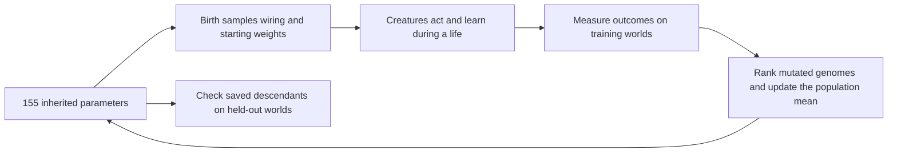
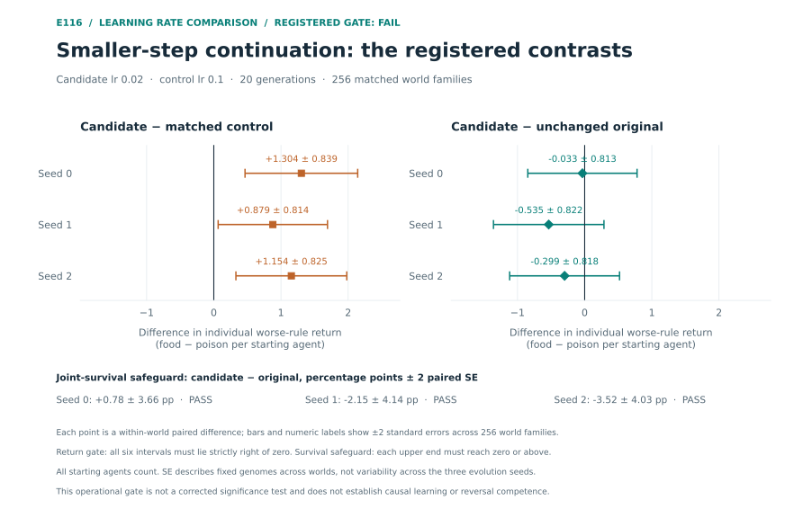
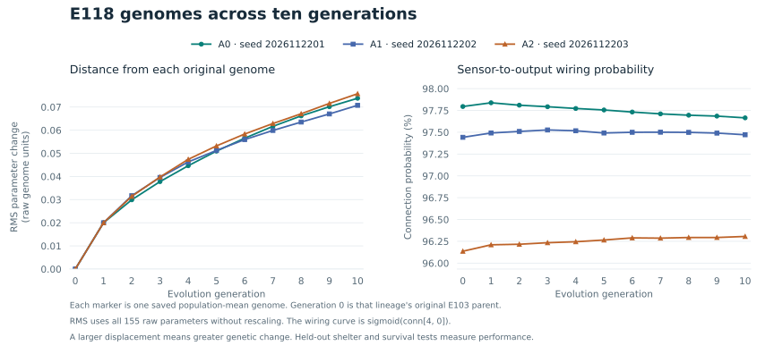

# Seed

Seed is a small simulation where creatures forage, avoid poison and seek shelter when the world turns cold. We track what changes during a life, what experience a newborn can inherit, and what evolution changes in the genome. [Genome design and history](#the-genome-and-the-brain-it-builds) · [Donor experiment](#what-newborns-gained-from-earlier-lives) · [Ten generations of shelter selection](#ten-generations-of-shelter-selection) · [Training with inherited experience](#evolving-with-inherited-experience)

## What the creatures do

Four creatures move around a 16 × 16 grid. Each sees a small patch around itself and can move one square or stay put. There are two kinds of items, A and B. In one world, A is food and B is poison. In another world, B is food and A is poison. The rule is hidden from the creatures. Food adds energy, poison drains it, and staying alive uses a little energy each turn. A life lasts up to 300 turns and ends early if energy reaches zero. In some tests, the food rule switches halfway through.

## The genome and the brain it builds

We chose the genome format, cell types, observations, actions and learning equations. Evolution can change all **155 numerical parameters** within that design. There are five cell types. All inputs share a type, the hidden units use three types with 16 units each, and the six outputs share the last type. Each pair of types has its own wiring and learning parameters. [Genome and development code](seed/seed.py#L44)

| Inherited field | Shape | Numbers | What it controls |
| --- | --- | ---: | --- |
| `conn` | 5 × 5 | 25 | Probability of a connection from one cell type to another, stored as a logit |
| `wscale` | 5 × 5 | 25 | Scale of the random starting connection strengths, stored as a logarithm |
| `hebb` | 5 × 5 × 4 | 100 | Four coefficients combining source activity, destination activity, their product and a constant in the learning update |
| `log_eta` | Scalar | 1 | Overall rate of connection-strength learning, stored as a logarithm |
| `mod` | Vector | 3 | How energy change, prediction error and a bias gate learning |
| `log_plr` | Scalar | 1 | Prediction-learning rate, stored as a logarithm |
| **Total** | | **155** | |

In the shelter world, each brain has **183 units**. Its 129 inputs describe five local 5 × 5 maps — item A, item B, other creatures, their signals and shelter — plus energy, energy change, a constant and the cold-season cue. There are 48 hidden units, five movement outputs and one signaling output. The original food-world brain has 103 inputs and 157 units overall. Inputs receive the current observations directly. The sampled network can connect inputs to hidden units or outputs, and connect hidden and output units recurrently. The engine excludes connections into inputs and connections from a unit to itself. [Dimensions and wiring](seed/seed.py#L44) · [Observations](seed/seed.py#L108)



Evolution changes the inherited parameters across generations. Development draws each newborn's particular connections from those parameters. Lifetime learning changes the strengths of its connections and its observation predictor. The collective-memory mechanism also lets a later newborn receive acquired changes on matching sensor-to-output connections. These are distinct places where experience can affect a creature. [Learning update](seed/seed.py#L147) · [Evolution update](seed/seed.py#L401) · [Memory transfer](seed/lineage.py#L217)

## How the saved genomes evolved

The original A0, A1 and A2 runs each completed **200 generations**. Comparing their saved starting and final genome files shows changes in all 155 coordinates. The table follows three interpretable parameters from the beginning to generation 200. The wiring probability applies to each permitted sensor-to-output connection. The Hebbian coefficient multiplies source activity by destination activity, with the evolved learning rate and modulator also affecting the update. [A0 files](runs/20261112-023245_E103-A-blank-s0) · [A1 files](runs/20261112-050319_E103-A-blank-s1) · [A2 files](runs/20261112-102755_E103-A-blank-s2)

| Genome | Sensor-to-output wiring probability | Sensor-to-output Hebbian coefficient | Prediction-error contribution to the modulator |
| --- | ---: | ---: | ---: |
| A0 | 26.89% → 97.80% | −0.163 → 6.533 | 0.000 → 0.427 |
| A1 | 26.89% → 97.44% | 0.068 → 6.142 | 0.000 → 0.525 |
| A2 | 26.89% → 96.14% | −0.078 → 4.975 | 0.000 → 0.664 |

These are exact saved parameter values rounded for display. Error bars apply to performance measured across worlds. The table documents what changed genetically, while the learning and survival evaluations establish what those changes achieve. Moving every parameter can include changes to entries that the architecture masks out.

For a concrete newborn, the first recipient in the E117 development benchmark has **746 present connections out of 774 possible** in its 6 × 129 sensor-to-output block. Its paired inherited-memory version receives changed starting strengths on those 746 connections. Both versions share the same sampled wiring. That record illustrates the relationship between the evolved connection probabilities, one newborn's actual connections and inherited lifetime experience. [Saved development arrays](runs/20261121-172316_E117-benchmark/families/family_0000.npz)

## How a creature learns during its life

1. **Look and act.** The brain takes in nearby items, other creatures and their signals, and its own energy. Brain activity carries over from one turn to the next. The brain uses that activity to choose a move and keeps track of the move it actually made.
2. **Get feedback.** If the creature lands on an item, it eats it. On the next turn, the brain gets the change in energy and compares what it sees with what it expected to see.
3. **Adjust the brain.** One update helps the brain make a better prediction next time. The other changes the strength of existing connections using the activity from the last move. The genome controls how the energy change and the size of the prediction error influence that update.

For example, one starting genome is designed to strengthen the link between seeing an item on the right and moving right when that move gains energy. If the move loses energy, the same rule can weaken that link. That gives the next decision a chance to use the last experience. This example comes from Seed's hand-written starting rule. Evolution can discover different ways to use the feedback. [Brain update code](seed/seed.py#L135) · [Example starting genome](seed/seed.py#L71)

## What a generation means

A **turn** is one action in the grid. A **life** is one creature's time in that world. A **generation** is one round of training that tests many slightly different genomes, each across several fresh lives.

1. **Make candidates.** Start with the genome that training has reached so far. Make copies with small random changes to its numbers. The candidates come in pairs, with one copy adding a change and the other subtracting it.
2. **Let them live.** Try each candidate on the same set of training worlds for that round. Build new brains from the candidate, then let the creatures act and learn through a full life.
3. **Score and update.** In the original experiment, a creature's score was food eaten minus poison eaten. Seed averages scores across creatures and worlds, ranks the candidates, and uses those ranks to update the genome. The next generation tries new changes around that updated genome.

In the original A runs, one generation tested **128 candidate genomes in 8 worlds each**, with 4 creatures per world. Each run repeated that process **200 times**. A new creature inherits the instructions for building and updating a brain. It starts life with fresh wiring and no memory of the lives that came before it. [One run's settings](runs/20261112-023245_E103-A-blank-s0/config.json) · [Evolution code](seed/seed.py#L332)

A **random seed** is a number that sets the sequence of random choices in a training run. We repeat experiments with different seeds to see whether the same pattern shows up across runs.

## How we check whether learning helps

We test saved genomes on worlds set aside from training. To check learning during a life, we look at food choices over time and compare a genome with its brain updates on and off. To check flexibility, we can switch the food rule halfway through a life or replay the same starting creature in two separate lives, one under each rule. We track survival alongside food choices because some creatures die before they have many chances to eat. [Learning and rule-switch tests](results/EVAL_V3.md) · [Paired-rule tests](results/EVAL_V4.md)

## What we found

- **The creatures got better at choosing food when the rule stayed fixed.** Among creatures that ate at least twenty times, the twentieth meal was more likely to be food than the first. The gains in three separate runs were 27 ± 2, 21 ± 2 and 25 ± 2 percentage points. When the rule switched during a life, food choices still hovered around half correct near the end. [Learning and rule-switch results](results/EVAL_V3.md)
- **A high average score can hide a one-rule specialist.** We trained a second type of brain whose connections stay the same strength throughout its life. It outscored the learning brains in all three runs on the original measure of food eaten minus poison eaten. Each of these brains did well under one food rule and poorly under the other. That led us to replay the same starting creature under both rules and score it on its worse result. [Fixed-weight comparison](results/E113_BASELINE.md) · [Paired-rule test](results/EVAL_V4.md)

## What happened when we trained for both rules?

We took the three brains from the first learning experiments and trained two versions of each for another 50 generations. One was rewarded for its average score across the two rules. The other was rewarded for each creature's worse result. Both versions scored below their starting brain on the harder-rule test, across 256 worlds set aside for testing. [Full results and raw data](results/EVAL_V5.md)

The numbers below show how much the harder-rule score changed when we trained specifically to improve it. The score counts food minus poison per creature. A negative change means the new brain scored lower than its own starting point. The ± values show one standard error across matched test worlds.

| Starting brain | Change after training |
| --- | ---: |
| A0 | −1.47 ± 0.41 |
| A1 | −2.23 ± 0.43 |
| A2 | −1.83 ± 0.40 |

This experiment, **E115**, passed none of its six required score comparisons. Two of the three brains also missed the target for keeping creatures alive under both rules. The original three brains are still our benchmark for this test. [See the chart for both training versions and all three original brains](results/figures/e115-objective-comparison.svg)

## Smaller training steps helped, but the original brains still set the benchmark

E116 trained each original genome for 20 more generations at two update sizes. The smaller step (0.02) beat the larger one (0.10) on all three lineages, on 256 fresh paired worlds. The score measures each creature's lower food-minus-poison return under the two food rules. Each ± below is one standard error across paired worlds.

| Lineage | Smaller step minus larger step | Smaller step minus original brain |
| --- | ---: | ---: |
| A0 | +1.30 ± 0.42 | −0.03 ± 0.41 |
| A1 | +0.88 ± 0.41 | −0.54 ± 0.41 |
| A2 | +1.15 ± 0.41 | −0.30 ± 0.41 |

**E116 failed its improvement gate.** All three survival safeguards passed. None of the smaller-step descendants beat its own starting brain by the required margin. We will keep A0, A1 and A2 as the reference genomes for the next question. [Full evidence](results/EVAL_V6.md) · [Registered comparison](experiments/E116_PROPOSAL.md)



## A world with shelter and memory across lives

Creatures in the new world can see nearby shelter. Moving costs energy. Halfway through a life the weather turns cold, and a creature that ends its turn outside loses extra energy. In a controlled check, staying outdoors left a creature with 0.750 energy and moving into shelter left it with 0.875.

When a cohort's life ends, Seed saves what its members learned on connections from senses to actions. A newborn develops its own wiring. It receives earlier changes only on connections it actually has. An agent that dies early contributes its last living weights. The saved table can be loaded in a later local session.

One software check reused the original A0 genome across **three cohorts of two newborns**, with matched fresh-weight controls. Both newborns in each later cohort received changed starting weights. In the cold world, one of two creatures reached shelter in each group, and all survived. This verifies the transfer mechanism. Measuring a survival or navigation benefit requires independent lineages on held-out worlds. [Run and inspect the example](experiments/ECOLOGY_API.md) · [Saved observations](runs/20261121-062635_ecology-transfer-smoke-a0/summary.json) · [Proposed comparisons](experiments/ECOLOGY_TRANSFER.md)

### Persistence after a setback

The optional `--persistence` trait gives “never giving up” a specific meaning in this world. A cold creature outside shelter can remember the direction of a shelter it saw for up to four moves after it disappears from view. If two successive visible checks show no progress, it increases the chance of trying another move. Reaching shelter, warmth or an expired memory clears the goal. The normal controller still chooses each action and the creature still pays its energy costs.

In a matched check with the original A0 genome, newborns with shared memory spent four agent-turns pursuing an out-of-sight shelter in the cold world. One of two reached shelter with the trait on, and one of two with it off. This is a programmed behavior. Whether it improves survival, or whether evolution can discover it unaided, remains open. [Trait enabled](runs/20261121-074534_ecology-persistence-a0-on/summary.json) · [Trait disabled](runs/20261121-074522_ecology-persistence-a0-off/summary.json)

All 208 software tests passed on Windows, including the paired persistence checks and compatibility with earlier experiments. [Verification run](https://github.com/Winter-Soren/seed/actions/runs/44856721457)

## What newborns gained from earlier lives

**Newborns reached shelter sooner with inherited experience in all three lineages.** In each of 768 unseen world families, a donor cohort lived through a cold season. Newborns then faced a different world in two matched groups. One group received the donors' acquired changes on connections it also possessed. The other started fresh. Both had ordinary lifetime learning active and the optional persistence trait off.

| Original genome | Fresh start, turns | Inherited experience, turns | Turns saved | Survival gain, percentage points |
| --- | ---: | ---: | ---: | ---: |
| A0 | 161.6 ± 4.5 | 123.2 ± 3.8 | **38.4 ± 5.3** | **9.0 ± 1.2** |
| A1 | 160.0 ± 4.1 | 115.4 ± 3.8 | **44.6 ± 5.4** | **10.7 ± 1.5** |
| A2 | 145.2 ± 4.3 | 107.9 ± 3.3 | **37.3 ± 5.4** | **6.8 ± 1.0** |

Times are measured from birth to the first turn ending alive in shelter. Outside-born creatures that died or never arrived count as 301 turns. Each lineage had 256 paired worlds. The ± values are one world-level standard error, paired for the differences. With inherited weights, 726 of 960 outside-born A0 newborns arrived, 759 of 955 A1s and 793 of 958 A2s. The corresponding fresh-start counts were 543, 544 and 607. Survival at the end of life remained low even with inheritance: 12.2%, 15.9% and 7.7%, respectively. [Full estimates](results/RESULTS.md) · [Independent event audit](results/diagnostics/E117-independent-audit.json)

The comparison establishes that an earlier cohort's experience helped its successors on new worlds. Most first arrivals in the inherited groups came before the cold started (650, 690 and 702). Better foraging or exploration could explain some of the gain. Identifying what information the archive carried requires a separate experiment.

## Ten generations of shelter selection

**All three genomes evolved. None of the three descendants cleared the required improvement over its parent.** For each lineage we mutated 16 candidate genomes per generation and scored them on four fresh training worlds. After ten generations, the final descendant and its original parent each faced 128 new, matched worlds. Every creature had the same shelter cues, cold costs and programmed persistence trait. Every life started with fresh weights.



| Lineage | Parent, turns to shelter | Descendant, turns to shelter | Turns saved by evolution | Survival change, percentage points |
| --- | ---: | ---: | ---: | ---: |
| A0 | 142.0 ± 5.8 | 148.6 ± 6.0 | −6.6 ± 6.0 | 0.0 ± 0.9 |
| A1 | 157.7 ± 5.9 | 166.2 ± 6.1 | −8.5 ± 6.4 | −0.6 ± 1.2 |
| A2 | 147.3 ± 5.6 | 142.4 ± 5.8 | +5.0 ± 6.9 | +0.4 ± 1.1 |

Positive turns saved means the descendant reached shelter sooner. The ± values are one world-level standard error, paired for the changes. Deaths and missed arrivals count as 301 turns. All three lineages met the survival safeguard. The audit reconstructed all 30 selection updates from the candidates and their training scores. It also checked every held-out result against the saved events. [Independent audit](results/diagnostics/E118-independent-audit.json) · [Results index](results/RESULTS.md) · [Figure builder](tools/build_e118_genome_figure.py)

The original parents remain the reference genomes. This ten-generation budget produced no verified gain in shelter finding. The strongest replicated improvement so far came from giving newborns donor experience. A separate comparison using a scrambled donor archive of matched size could test whether its specific contents account for that benefit.

## Evolving with inherited experience

**None of the three generation-20 descendants reliably beat its generation-19 parent. The accumulated archive slowed shelter finding in all three lineages.**

E119 continued the actual E118 generation-ten genomes and optimizer states. Before each new update, 16 creatures born from the current parent genome lived across four training worlds. On each sensory-to-output connection they possessed, their acquired weight changes were averaged and added to the archive. The next generation's candidates received those changes on their own matching connections. All 7,680 candidate births across the study received changed starting weights. The audit reconstructed all 30 evolutionary updates and all 30 archive updates. [Independent audit](results/diagnostics/E119-independent-audit.json)

For each lineage, the same 128 unseen world families were used for every comparison below. Each number is the **turns saved by the generation-20 descendant with its accumulated archive**, ± one paired world-level standard error. Negative values mean it took longer to reach shelter.

| Lineage | Versus its immediate parent with the parent's archive | Versus its generation-ten founder with an empty archive | Versus the same descendant with an empty archive |
| --- | ---: | ---: | ---: |
| A0 | −2.1 ± 3.1 | −34.9 ± 7.1 | −48.0 ± 8.1 |
| A1 | −40.8 ± 6.3 | −62.2 ± 7.3 | −56.4 ± 8.1 |
| A2 | +6.3 ± 6.0 | −20.8 ± 7.4 | −23.5 ± 7.0 |

Only A2 had a positive parent comparison, and its gain fell short of two standard errors. Each lineage met the relative survival safeguard, but absolute survival was low. Of 512 newborns assigned per group, the parent and descendant survival counts were 0 and 0 in A0, 8 and 6 in A1, and 3 and 4 in A2. The paired survival changes were 0.00 ± 0.00, −0.39 ± 0.78 and +0.20 ± 0.34 percentage points. Deaths and missed arrivals counted as 301 turns in the latency score. The original reference genomes remain in place. [Results table](results/RESULTS.md) · [Lab notebook](experiments/LOG.md)

E117 showed a benefit from a single donor cohort paired with its successors. In E119 the same descendant did better with its accumulated archive cleared. The experiments differ in donor experience, the number of transfers and training, so the cause of the difference is still open.

## Learning by watching another creature

**E120's observational-learning gate failed in all three lineages.** Each newborn watched the last 150 turns of an experienced teacher's life, then acted alone in a new layout with the same food rule. The four matched versions of that newborn saw the intact movie, the same movie with A/B colors swapped for half the families under each rule, a blank view, or the scenery with the teacher and its signal removed. Each version started with an empty archive and learned through its own brain.

The table reports 128 unseen families per lineage. Teacher accuracy is the fraction of its late meals that were food. Newborn success means its first meal alone was food, counting every assigned newborn. The three gains are intact-movie success minus the corresponding control, in percentage points. Every ± value is one family-level standard error, paired for the gains.

| Lineage | Teacher late food (%) | Newborn first food (%) | Gain vs color-reassigned movie | Gain vs blank view | Gain vs scenery alone |
| --- | ---: | ---: | ---: | ---: | ---: |
| A0 | 82.9 ± 0.9 | 52.3 ± 4.4 | −1.6 ± 3.5 | 0.0 ± 5.1 | +8.6 ± 4.2 |
| A1 | 81.1 ± 1.0 | 51.6 ± 4.4 | +3.9 ± 3.6 | 0.0 ± 5.1 | +0.8 ± 4.5 |
| A2 | 81.8 ± 0.8 | 50.0 ± 4.4 | −2.3 ± 3.2 | +0.8 ± 5.7 | +3.9 ± 5.1 |

A0 passed the first-food comparison against scenery alone. The registered gate required an advantage above two paired standard errors against all three controls, together with the survival safeguard. A2 also failed that safeguard against the color-reassigned movie. Its survival fell by **8.6 ± 3.3 percentage points**, from 99/128 to 88/128 newborns. All deaths and missed meals remained in the assigned groups. [Independent movie and event audit](results/diagnostics/E120-independent-audit.json) · [Full results](results/RESULTS.md)

The teachers made useful food choices, and watching changed newborns' own synaptic weights. These observations were insufficient to establish transfer of the food rule. E121 then tested whether the visible movies contained a readable clue.

## What information the demonstration films contain

**E121's readability gate passed in all three lineages.** A hand-engineered reader tracked the teacher's visible approaches to items and predicted the food color from 128 independent films per lineage. A second reader used only the item images and their movement across frames. Both readers use known camera geometry and fixed analysis rules. Their scores measure information available in the films.

| Teacher lineage | Tracking-reader accuracy (%) | Gain vs color-reassigned movie, percentage points | Films yielding an item-visit vote (%) | Item-only reader accuracy (%) |
| --- | ---: | ---: | ---: | ---: |
| A0 | 84.4 ± 2.3 | +34.4 ± 4.5 | 77.3 ± 3.7 | 84.0 ± 2.5 |
| A1 | 84.4 ± 2.5 | +35.9 ± 4.5 | 81.2 ± 3.5 | 83.6 ± 2.5 |
| A2 | 89.8 ± 1.9 | +43.0 ± 4.5 | 84.4 ± 3.2 | 87.9 ± 2.3 |

Every film remains in the denominator. Ties and films without a vote receive half credit. The ± values are one family-level standard error, paired for the gains. All three tracking readers met the registered requirements for coverage, accuracy and advantages above two standard errors over chance and the color-reassigned control. [Independent film reconstruction and reader audit](results/diagnostics/E121-independent-audit.json) · [Full results](results/RESULTS.md)

The item-only reader performed nearly as well. The camera follows the teacher, so scenery changes also reveal its route. Removing the teacher's visible body therefore leaves useful information in these films. The successful readers are hand-engineered analysis programs. The evolved newborns still failed E120's first solo-choice test despite this readable signal. E122 will test whether selection can produce observers that use it.

## Human-inspired research direction

The next experiment, E122, will **evolve the original observer genomes for the first food choice they make alone after watching**. Its teachers use the original A0/A1/A2 genomes. Selection will act on the observers, with fresh films and solo worlds used to check their descendants. If observational learning succeeds, a later experiment can test whether successive cohorts preserve and improve the behavior. These are proposed capabilities in a simulation. Human ancestry itself is a branching tree. [Research plan and study design](PLAN.md#human-inspired-research-direction--21-november-2026) · [Smithsonian Human Origins Program](https://humanorigins.si.edu/education/frequently-asked-questions)

## Try it locally

From the root of a clean checkout, use Python 3.12.10. The commands below create a local Python environment, install the pinned dependencies and run a small check on Windows PowerShell.

```powershell
python -m venv .venv
.\.venv\Scripts\python.exe -m pip install --no-cache-dir -r requirements.txt
.\.venv\Scripts\python.exe scripts/run_experiment.py --name smoke --quick
```

On macOS or Linux, use `python3` to create the environment and `.venv/bin/python` for the next two commands. The small check confirms the simulator runs and saves a `summary.json` in a new folder under `runs/`. For an example you can inspect without running anything, open the [first original brain's summary](runs/20261112-023245_E103-A-blank-s0/summary.json).

<details>
<summary>More setup and testing notes</summary>

On the owner's laptop, work from the checkout on D: and set temporary files to use that drive before setup.

```powershell
New-Item -ItemType Directory -Force .tmp | Out-Null
$env:TEMP = $env:TMP = (Resolve-Path .tmp).Path
```

For software tests, create `.tmp/` in the checkout and run `python -X utf8 -m unittest discover -s tests -v` with the environment's Python. Some tests need full Git history. The verified setup uses JAX on the Windows CPU. [CI workflow](.github/workflows/tests.yml)

</details>

## Where to look next

| If you want to… | Start here |
| --- | --- |
| See every recorded run | [Results index](results/RESULTS.md) |
| Read the hypotheses, commands and decisions | [Lab notebook](experiments/LOG.md) |
| Find the next experiment and the rules for running it | [Research plan](PLAN.md) · [Current status](TASK_STATE.md) · [Research rules](AGENTS.md) |
| See how the world and brains work in code | [Simulation](seed/seed.py) · [Experiment runner](scripts/run_experiment.py) |

The [earlier README](https://github.com/Winter-Soren/seed/blob/v0.5-evalv5/README.md) has the original tables and charts for the older experiments, including the hand-set starting brain and the connection growth tests.
