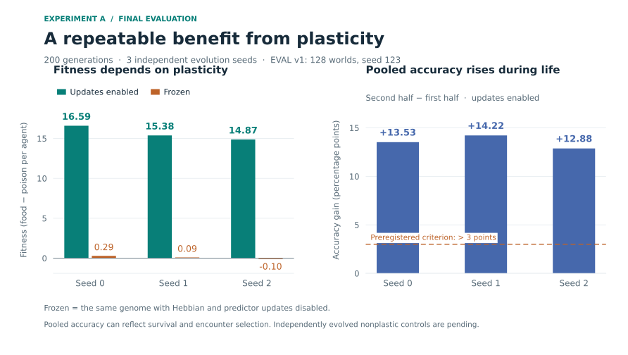
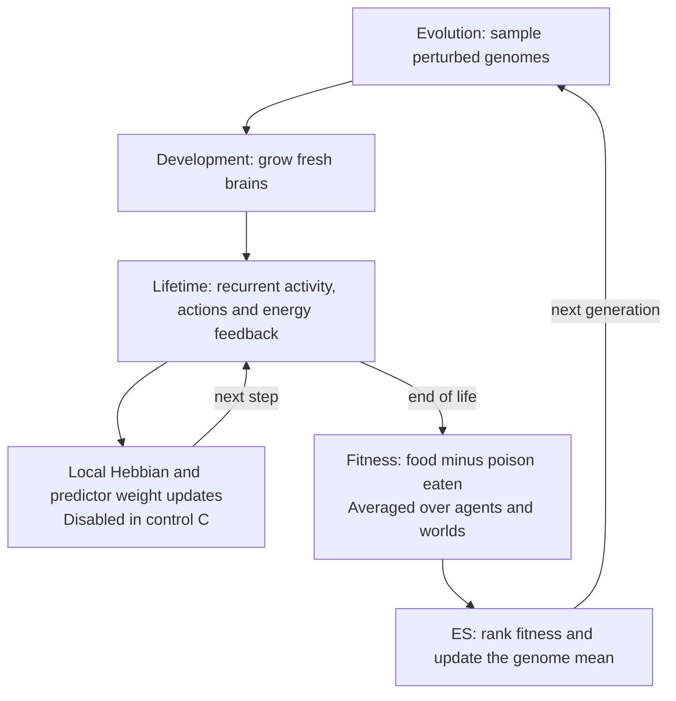
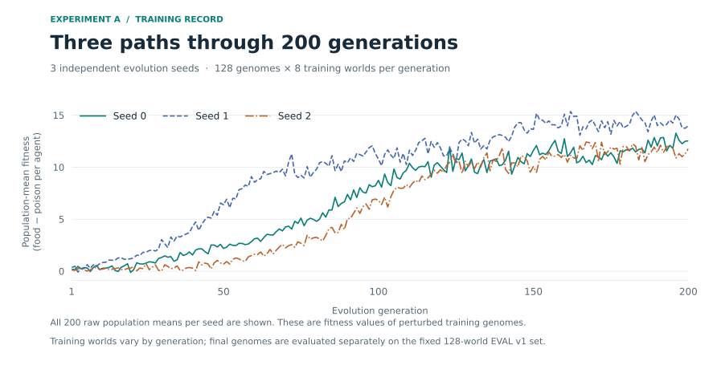

# Seed

**Evolve the rules. Grow a brain. Learn during a life.**

Can evolution discover rules that let a new brain learn from experience? Seed explores that question in a small, inspectable JAX simulation. A genome of **155 numbers** specifies how a recurrent brain grows and how its connections change. Its agents forage in worlds where the same kind of object can be food in one world and poison in another. Lifetime learning uses local updates, without labelled examples or backpropagation.

**Latest verified milestone · 12 Nov 2026:** evolution from a blank start passed the preregistered learning criterion in **3 of 3 seeds** after 200 generations. Food-choice accuracy rose by **12.88–14.22 percentage points** between the first and second halves of life, and fitness fell sharply when plasticity was disabled. [See the evidence](#what-the-experiments-show).



*Final genomes on fixed EVAL v1: 128 worlds, evaluation seed 123. Each enabled/frozen pair uses the same genome; accuracy gains pool eating events. Two independently evolved nonplastic controls are complete; seed 2 remains.*

## Three loops, one experiment

| Loop | What happens |
|---|---|
| **Evolution · across generations** | Evolution strategies search for genomes whose agents eat more food than poison. |
| **Development · at birth** | Each genome grows a brain from wiring rules; related agents share a genome but have different random wiring. |
| **Learning · during life** | Local Hebbian and prediction updates change the brain using its experience, including energy change and prediction error. |



Evolution changes the genome between generations; lifetime weight changes are not inherited. **Control C keeps recurrent state and energy feedback active while disabling both local weight updates.** After A's 3/3 result, this control asks whether independently evolved nonplastic agents can match its performance.

The current world is a 16 × 16 wrapping grid. Four related agents live for up to 300 steps, seeing only a local patch. Each world has a hidden rule assigning its two object types to food or poison. This makes a compact test bed for studying the interaction of evolution, development and plasticity.

## Try a small run

Open a terminal in the root of your local Seed checkout; cloning this private repository requires access. Start with a clean Git checkout and no other Seed job running. The verified environment is **Python 3.12 with JAX on CPU, on Windows**. The macOS/Linux commands are provided for setup but have not been exercised here.

**Windows · PowerShell**

```powershell
python -m venv .venv
.\.venv\Scripts\python.exe -m pip install --no-cache-dir -r requirements.txt
.\.venv\Scripts\python.exe scripts/run_experiment.py --name smoke --quick
.\.venv\Scripts\python.exe -X utf8 scripts/summarize.py
```

**macOS or Linux**

```bash
python3 -m venv .venv
.venv/bin/python -m pip install --no-cache-dir -r requirements.txt
.venv/bin/python scripts/run_experiment.py --name smoke --quick
.venv/bin/python scripts/summarize.py
```

<details>
<summary>Owner's Windows laptop: keep setup temporary files on D:</summary>

Use a checkout on D: and run these PowerShell commands before setup:

```powershell
New-Item -ItemType Directory -Force .tmp | Out-Null
$env:TEMP = $env:TMP = (Resolve-Path .tmp).Path
$env:PYTHONUTF8 = '1'
```

</details>

Open the new folder under `runs/`: `config.json` records the settings and source commit, `metrics.jsonl` records training progress, and `summary.json` contains the final learning and frozen evaluations. The generated [results table](results/RESULTS.md) gives an overview of recorded runs.

The `--quick` smoke run is an **integration check only**, not research evidence. To explore the completed research without running compute, start with the [A seed 0 summary](runs/20261112-023245_E103-A-blank-s0/summary.json) and the results below. A [Colab notebook](notebooks/Seed_v0.ipynb) is also available; its runtime is not benchmarked here.

## What the experiments show

**Experiment A: can evolution discover useful plasticity from a blank start? — PASS, 3/3 seeds.**

Each seed evolved for 200 generations. Final genomes were evaluated with **EVAL v1: 128 worlds, evaluation seed 123**. Fitness is food minus poison per agent. Accuracy is the fraction of eating events that consume food, pooled across agents. “Frozen” evaluates the same genome with plasticity disabled.

| A evolution seed | Learning fitness | Frozen fitness | Accuracy first → second half | Gain (percentage points) |
|---|---:|---:|---|---:|
| 0 | 16.59 | 0.29 | 70.49% → 84.02% | +13.53 |
| 1 | 15.38 | 0.09 | 68.76% → 82.98% | +14.22 |
| 2 | 14.87 | -0.10 | 69.37% → 82.25% | +12.88 |

The gate required a within-life accuracy gain **strictly above 3 percentage points** and clearly lower frozen fitness in at least 2 of 3 evolution seeds. All three passed. Their learning-minus-frozen fitness gaps are **16.30**, **15.28**, and **14.97**. This is the project's first replicated learning milestone, tagged `v0.1-a-evalv1`.

For context, the unevolved **biology prior**—a hand-set genome—scores **5.13** fitness, frozen **0.00**, with accuracy **56.86% → 67.39%**. Its three evaluations repeat the same genome and worlds, so they check repeatability rather than provide independent trials. The three random starting genomes score **-0.004**, **0.414**, and **0.230**.

**What this establishes:** evolved genomes benefit substantially from enabled plasticity in this toy domain. **What remains open:** pooled accuracy can rise through survival or encounter selection as well as individual learning. The lesion disables Hebbian and predictor updates together, while preserving recurrent state and energy feedback. It does not isolate hidden-rule inference by individual agents or establish general intelligence. The three-seed comparison with independently evolved nonplastic agents remains incomplete.

Values are rounded here. Exact measurements are in the [seed 0](runs/20261112-023245_E103-A-blank-s0/summary.json), [seed 1](runs/20261112-050319_E103-A-blank-s1/summary.json), and [seed 2](runs/20261112-102755_E103-A-blank-s2/summary.json) summaries; hypotheses, checks and decisions are in the [lab notebook](experiments/LOG.md).

**Experiment B: can gentle evolution improve the biology prior? — one successful seed; full gate pending.**

After 200 generations, B seed 0 reached **15.90** learning fitness versus the prior's **5.13**, an improvement of **10.77**. Frozen fitness was **-0.05**, a learning-minus-frozen gap of **15.95**. Pooled food-choice accuracy rose **68.57% → 83.53%** (**+14.96 percentage points**). This seed exceeds B's preregistered reference; the full gate requires success in at least 2 of 3 seeds and awaits B1/B2. Exact measurements are in the [B seed 0 summary](runs/20261112-131946_E104-B-bio-s0/summary.json).

**Experiment C: how does plastic evolution compare with a matched nonplastic control? — seeds 0/1 complete; seed 2 pending.**

Each completed A/C pair ran for 200 generations from the same starting genome, with matched settings except the plasticity switch, and was evaluated under EVAL v1.

| Evolution seed | A learning fitness | C nonplastic fitness (`final_frozen`) | A − C |
|---|---:|---:|---:|
| 0 | 16.59 | 0.49 | +16.11 |
| 1 | 15.38 | 0.12 | +15.25 |

Both observed pairs favor plastic evolution; the full planned three-seed comparison awaits C2. C's `final_learning` re-enables updates and is diagnostic only: **0.0625** for C0 and **0.169921875** for C1. Exact measurements are in the [C seed 0 summary](runs/20261112-224133_E105-C-noplastic-s0/summary.json) and [C seed 1 summary](runs/20261114-003141_E105-C-noplastic-s1/summary.json).

C0's frozen accuracy still rose **50.42% → 53.99%** (**+3.57 percentage points**), despite both synaptic update mechanisms being disabled. This exceeds the 3-point accuracy threshold and shows why accuracy gain alone cannot establish synaptic learning. Recurrent state and energy feedback remain active, and pooled scores can reflect survival or encounter selection.

C1's frozen accuracy rose **49.74% → 51.94%** (**+2.20 percentage points**); the same interpretation limits apply.

## Progress and next milestones



*All 600 recorded population means are shown without smoothing. These are fitness values of perturbed training genomes on changing training worlds, not fixed-genome learning trajectories or final EVAL v1 scores.*

The [figure data](results/figures/a-figure-data.json) links each series to its run artifacts and records source hashes with line endings normalized to LF. Rebuild both figures from the repository root with `.\.venv\Scripts\python.exe tools/build_readme_figures.py`; the [generator](tools/build_readme_figures.py) validates its inputs before plotting.

| Stage | Question | Status |
|---|---|---|
| **E100 · References** | How do random genomes and the biology prior behave under EVAL v1? | Measured; starting points recorded. |
| **E103 · A** | Can blank-start evolution reach the learning criterion? | **Passed in 3/3 seeds.** |
| **E104 · B** | Can gentle evolution improve the biology prior? | Seed 0 exceeds the prior; seeds 1/2 pending. Full gate pending. |
| **C · Nonplastic control** | How does A compare with independently evolved agents whose plasticity is disabled? | Seeds 0/1 favor A; seed 2 pending. |

The remaining queue is **C2 → B1 → B2**. C2 will complete the planned matched comparison: report A's learning fitness minus C's frozen fitness for each seed, retaining mixed outcomes if they occur. B passes only if final fitness exceeds the prior's **5.12890625** in at least 2 of 3 seeds. A and B use different evolution settings, so their difference cannot isolate initialization alone.

Complete these core comparisons before selecting the next research direction. Connectome-informed wiring, eligibility traces, sleep/replay and overlapping-generation culture remain roadmap ideas, not implemented milestones or demonstrated capabilities. Evaluation settings and worlds stay fixed.

## Reproduce a research run

A separate [BROADER v1 proposal](experiments/E108_BROADER_V1.md) prepares saved-genome
tests under resource-density and metabolic-cost shifts. Its development fixtures are
operational checks. The owner approved the protocol; a one-world development panel passed,
and the first final panel is next in its coordinated slot. These conditions remain in
the same food/poison task family. EVAL v1 is unchanged.

Preregister each research run in `experiments/LOG.md` and commit before launching; the runner rejects uncommitted code. Scientific comparisons require evolution seeds **0, 1 and 2**. Preserve every run folder, including interrupted and failed runs.

The laptop benchmark averaged about **49.5 seconds per generation** after the first. Use bounded sessions for a 200-generation run:

```powershell
.\.venv\Scripts\python.exe scripts/run_experiment.py --name A-blank --start blank --generations 200 --seed 0 --max-train-seconds 7200
.\.venv\Scripts\python.exe scripts/run_experiment.py --resume 'runs/<run-folder>' --max-train-seconds 7200
```

For macOS/Linux, use `.venv/bin/python` in place of `.\.venv\Scripts\python.exe` in these commands and the figure rebuild command.

Resume only an unfinished run; its original generation target is retained. The training limit excludes setup/evaluation and can overrun by one generation. Run one long job at low priority and monitor full wall time to keep each invocation below **3 hours**. Disk and memory supervision is separate from the runner's training limit; use the current safeguards recorded in the [lab notebook](experiments/LOG.md).

A0 took **144.61 minutes** and A2 **157.11 minutes** of combined process wall time, excluding pauses between segments. A1's full wall time is unknown because its first process ended abnormally. A resumed run's final `train_minutes` covers its last segment, not the full experiment.

## Explore the project

| Path | Contents |
|---|---|
| [seed/seed.py](seed/seed.py) | JAX engine: world, brain development, plasticity, evolution and evaluation. |
| [scripts/run_experiment.py](scripts/run_experiment.py) | Tracked, resumable experiment runner. |
| [results/RESULTS.md](results/RESULTS.md) | Generated index of recorded runs. |
| [experiments/LOG.md](experiments/LOG.md) | Append-only hypotheses, results, incidents and decisions. |
| [HANDOFF.md](HANDOFF.md) | Original design and roadmap; use the current lab notebook for subsequent results and decisions. |
| [AGENTS.md](AGENTS.md) | Research, integrity and resource rules. |

**Provenance:** the [commit mapping](experiments/COMMIT_ATTRIBUTION_MAP_20261112.json) connects recorded source hashes to commits with corrected authorship. Historical run records retain their original hashes; the authorship repair does not change experiment contents. The repository remains private.
