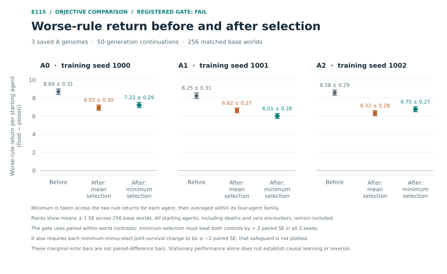

# E115: selection for individual performance across opposite rules

**Artifact validity: PASS. Registered continuation gate: FAIL.** All six training runs reached generation 50; all 14 final controllers and 56 conditions completed, and the independent audit checked 70 raw archives and nine copied genomes. The gate passed 0/6 required return-improvement checks and 1/3 survival safeguards. Improvement under this fixed continuation budget is not established by the registered gate.

The original [interrupted attempt](../runs/20261119-081846_E115-v5/summary.json) stopped after eight complete panels and three additional conditions during the confirmed Modern Standby interruption. It remains unchanged with no gate. This separately registered recovery1 repeats the same code, inputs, seed, worlds and decision rule. The [preservation manifest](diagnostics/E115-interrupted-files.json) retains all 54 original file hashes. The independent audit verifies that all 35 overlapping condition archives and eight overlapping paired archives have bit-identical array contents, and that their scientific summary values are identical. The repeated prefix is retained evidence, not additional independent worlds.

The min-objective continuations' mean individual minimum returns are **7.216 ± 0.293, 6.011 ± 0.276, 6.753 ± 0.273** for seeds 0, 1 and 2. Their paired improvements over the corresponding mean-objective final are **0.284 ± 0.404, -0.611 ± 0.362, 0.436 ± 0.381**, and over the unchanged start are **-1.475 ± 0.406, -2.234 ± 0.427, -1.828 ± 0.403**. These are means ± one paired-world standard error. The exact unrounded comparisons determine the gate.

*Both continuation objectives scored below their unchanged starts in every seed. Error bars describe variation across 256 world families for each fixed genome, not variation across evolution seeds.*

## Design and fixed decision rule

This is an objective-only continuation study of the three saved A genomes. Each original genome starts two fresh ES runs with zero Adam moments: one maximizes mean individual return across the two stationary rules; the other takes each individual's lower return across those rules before averaging. Both arms retain the same plastic controller, population 64, four base-world pairs per generation, sigma and learning rate 0.1, L2 0.005, and 50 generations. Matched training seeds are 1000, 1001 and 1002. The two arms have matched starting bytes, exposure and random-stream schedules; they do not inherit the original run's optimizer state. Final generation-50 genomes are evaluated without selecting a best checkpoint.

EVAL v5 uses fresh seed 2026111903 and 256 base worlds with four starting agents each. Every controller faces stationary rule 0, stationary rule 1, reversal from rule 0 and reversal from rule 1; reversal occurs before eating at step 150. Each replay begins with the same initial grid, positions, agent identities and random/development streams. These are fresh matched lives: activity, learned weights and experience do not carry between replays. Later trajectories may differ. The unchanged starts and five references are evaluated once each in this common bundle.

PASS requires all six training runs and all 14 panels to be valid; in every one of the three seeds, the min-objective final must exceed both its mean-objective final and unchanged start in individual minimum return by strictly more than two paired-world SE. No seed's min-minus-start joint-survival difference may fall below minus two paired-world SE. The unchanged-start comparison prevents a degraded control from counting as improvement. Equality at the return threshold fails; equality at the survival boundary is allowed. This is an operational research gate, with no multiplicity-adjusted significance or causal-learning claim. Reversal is reported separately and is not a promotion criterion.

| Seed | Gate component | Difference ± paired SE | Required mean difference | Decision |
| --- | --- | --- | --- | --- |
| 0 | Minimum return: min − mean | 0.284 ± 0.404 | > 0.807479 | FAIL |
| 0 | Minimum return: min − start | -1.475 ± 0.406 | > 0.812404 | FAIL |
| 0 | Joint survival: min − start | -0.025 ± 0.020 | >= -0.039979 | PASS |
| 1 | Minimum return: min − mean | -0.611 ± 0.362 | > 0.723260 | FAIL |
| 1 | Minimum return: min − start | -2.234 ± 0.427 | > 0.854843 | FAIL |
| 1 | Joint survival: min − start | -0.050 ± 0.021 | >= -0.042192 | FAIL |
| 2 | Minimum return: min − mean | 0.436 ± 0.381 | > 0.762485 | FAIL |
| 2 | Minimum return: min − start | -1.828 ± 0.403 | > 0.806622 | FAIL |
| 2 | Joint survival: min − start | -0.081 ± 0.020 | >= -0.040679 | FAIL |

## All fourteen controllers

Every ± value below is one SE over 256 independent base worlds. Average paired lives and agents within each world first; agents, rules and replay conditions are not independent extra samples. Errors concern worlds for fixed genomes, not variability across evolution seeds. All starting agents remain in return and survival denominators, including early deaths and zero-encounter lives. Return is food minus poison per starting agent; survival is a fraction.

| Controller | Stationary fitness ± SE | Individual minimum return ± SE | Joint stationary survival ± SE | Post-flip return ± SE | Reversal final survival ± SE |
| --- | --- | --- | --- | --- | --- |
| Start 0 | 15.395 ± 0.254 | 8.690 ± 0.305 | 0.704 ± 0.014 | -2.713 ± 0.084 | 0.409 ± 0.012 |
| Mean 0 | 13.501 ± 0.237 | 6.932 ± 0.296 | 0.665 ± 0.016 | -2.200 ± 0.091 | 0.435 ± 0.012 |
| Min 0 | 13.300 ± 0.254 | 7.216 ± 0.293 | 0.679 ± 0.014 | -2.040 ± 0.085 | 0.486 ± 0.012 |
| Start 1 | 14.971 ± 0.271 | 8.245 ± 0.314 | 0.707 ± 0.014 | -2.515 ± 0.092 | 0.432 ± 0.012 |
| Mean 1 | 12.922 ± 0.252 | 6.622 ± 0.270 | 0.666 ± 0.015 | -2.131 ± 0.085 | 0.448 ± 0.011 |
| Min 1 | 12.073 ± 0.242 | 6.011 ± 0.276 | 0.657 ± 0.015 | -2.037 ± 0.084 | 0.441 ± 0.011 |
| Start 2 | 15.096 ± 0.247 | 8.581 ± 0.288 | 0.731 ± 0.014 | -2.677 ± 0.075 | 0.437 ± 0.010 |
| Mean 2 | 12.646 ± 0.227 | 6.317 ± 0.285 | 0.646 ± 0.015 | -2.218 ± 0.077 | 0.422 ± 0.011 |
| Min 2 | 12.793 ± 0.235 | 6.753 ± 0.273 | 0.650 ± 0.015 | -2.225 ± 0.086 | 0.447 ± 0.011 |
| Fixed A | 39.154 ± 0.610 | -3.889 ± 0.017 | 0.007 ± 0.003 | -3.741 ± 0.039 | 0.042 ± 0.006 |
| Fixed B | 39.881 ± 0.659 | -3.853 ± 0.021 | 0.008 ± 0.003 | -3.809 ± 0.027 | 0.033 ± 0.005 |
| A/B mixture | 37.482 ± 1.372 | -3.957 ± 0.011 | 0.000 ± 0.000 | -2.504 ± 0.077 | 0.199 ± 0.010 |
| Random walk | -0.010 ± 0.055 | -2.881 ± 0.027 | 0.012 ± 0.003 | 0.010 ± 0.044 | 0.397 ± 0.007 |
| Rule-knowing greedy | 82.906 ± 0.925 | 70.553 ± 0.967 | 1.000 ± 0.000 | 24.445 ± 0.502 | 1.000 ± 0.000 |

Stationary fitness averages both stationary rules. Individual minimum return takes the lower return across those rules for each agent before averaging. Joint survival requires the same agent identity to survive both stationary replays. Post-flip return averages food minus poison over steps [150,300) in both reversed lives; reversal final survival averages both reversed endpoints. A zero post-flip return may reflect death before the flip. The min-objective post-flip returns are **-2.040 ± 0.085, -2.037 ± 0.084, -2.225 ± 0.086**; stationary-gate success cannot establish reversal recovery or pass the later randomized-reversal rung.

## Every original condition

Each row starts with 1,024 agents. Rule 0 initially makes A food and rule 1 makes B food. The before-step-150 column uses the same clock boundary in stationary lives, without changing their rule. Food, poison, deaths and no-encounter entries are observed counts; they are not independent sample sizes.

Greedy-normalized fitness is **100 × mean controller fitness / mean rule-knowing greedy fitness in the same condition**. It is a ratio of means, not an average of world-by-world ratios. Its ± value is the paired-world delta-method SE from `eval_v3.ratio_se`, expressed in percentage points (pp): preserve controller/greedy pairing within each of the 256 world families, including covariance. The greedy reference is **100 ± 0** against itself in every condition. Negative values remain negative; percentages are not clipped. The greedy policy knows the current food rule and is a reference, not a proven upper bound. This reporting addition does not change any gate or raw result.

| Controller | Condition | Fitness ± SE | Fitness (% of greedy) ± SE (pp) | Alive before 150 ± SE | Final survival ± SE | Food | Poison | Deaths / 1,024 | No encounters / 1,024 |
| --- | --- | --- | --- | --- | --- | --- | --- | --- | --- |
| Start 0 | stationary_r0 | 15.304 ± 0.402 | 18.618 ± 0.577 | 0.869 ± 0.011 | 0.843 ± 0.012 | 23082 | 7411 | 161 | 0 |
| Start 0 | stationary_r1 | 15.486 ± 0.327 | 18.521 ± 0.510 | 0.871 ± 0.010 | 0.844 ± 0.011 | 23345 | 7487 | 160 | 0 |
| Start 0 | reversal_r0 | 3.633 ± 0.193 | 5.365 ± 0.289 | 0.869 ± 0.011 | 0.409 ± 0.017 | 14736 | 11016 | 605 | 0 |
| Start 0 | reversal_r1 | 3.452 ± 0.164 | 5.035 ± 0.246 | 0.871 ± 0.010 | 0.409 ± 0.016 | 14791 | 11256 | 605 | 0 |
| Mean 0 | stationary_r0 | 13.772 ± 0.351 | 16.755 ± 0.466 | 0.873 ± 0.011 | 0.833 ± 0.012 | 21807 | 7704 | 171 | 0 |
| Mean 0 | stationary_r1 | 13.230 ± 0.357 | 15.823 ± 0.466 | 0.848 ± 0.011 | 0.806 ± 0.012 | 21250 | 7702 | 199 | 0 |
| Mean 0 | reversal_r0 | 3.150 ± 0.185 | 4.652 ± 0.270 | 0.873 ± 0.011 | 0.431 ± 0.017 | 14279 | 11053 | 583 | 0 |
| Mean 0 | reversal_r1 | 3.071 ± 0.168 | 4.479 ± 0.248 | 0.848 ± 0.011 | 0.438 ± 0.016 | 14044 | 10899 | 575 | 0 |
| Min 0 | stationary_r0 | 13.302 ± 0.350 | 16.183 ± 0.498 | 0.884 ± 0.010 | 0.841 ± 0.011 | 20908 | 7287 | 163 | 0 |
| Min 0 | stationary_r1 | 13.299 ± 0.363 | 15.905 ± 0.526 | 0.855 ± 0.011 | 0.818 ± 0.012 | 20947 | 7329 | 186 | 0 |
| Min 0 | reversal_r0 | 3.939 ± 0.205 | 5.817 ± 0.306 | 0.884 ± 0.010 | 0.512 ± 0.017 | 14380 | 10346 | 500 | 0 |
| Min 0 | reversal_r1 | 3.369 ± 0.180 | 4.913 ± 0.267 | 0.855 ± 0.011 | 0.461 ± 0.016 | 13810 | 10360 | 552 | 0 |
| Start 1 | stationary_r0 | 14.653 ± 0.380 | 17.827 ± 0.521 | 0.865 ± 0.011 | 0.837 ± 0.012 | 22776 | 7771 | 167 | 0 |
| Start 1 | stationary_r1 | 15.289 ± 0.424 | 18.285 ± 0.592 | 0.887 ± 0.010 | 0.847 ± 0.011 | 23465 | 7809 | 157 | 0 |
| Start 1 | reversal_r0 | 3.414 ± 0.186 | 5.042 ± 0.277 | 0.865 ± 0.011 | 0.427 ± 0.016 | 14900 | 11404 | 587 | 0 |
| Start 1 | reversal_r1 | 3.711 ± 0.187 | 5.412 ± 0.277 | 0.887 ± 0.010 | 0.437 ± 0.017 | 15104 | 11304 | 577 | 0 |
| Mean 1 | stationary_r0 | 13.010 ± 0.349 | 15.827 ± 0.471 | 0.861 ± 0.011 | 0.823 ± 0.013 | 21321 | 7999 | 181 | 0 |
| Mean 1 | stationary_r1 | 12.834 ± 0.342 | 15.349 ± 0.482 | 0.846 ± 0.012 | 0.819 ± 0.012 | 21094 | 7952 | 185 | 0 |
| Mean 1 | reversal_r0 | 3.446 ± 0.178 | 5.089 ± 0.266 | 0.861 ± 0.011 | 0.452 ± 0.016 | 14600 | 11071 | 561 | 0 |
| Mean 1 | reversal_r1 | 3.222 ± 0.185 | 4.698 ± 0.274 | 0.846 ± 0.012 | 0.443 ± 0.016 | 14305 | 11006 | 570 | 0 |
| Min 1 | stationary_r0 | 12.042 ± 0.340 | 14.650 ± 0.489 | 0.854 ± 0.011 | 0.811 ± 0.012 | 19970 | 7639 | 194 | 0 |
| Min 1 | stationary_r1 | 12.104 ± 0.336 | 14.476 ± 0.444 | 0.866 ± 0.011 | 0.825 ± 0.012 | 20023 | 7628 | 179 | 0 |
| Min 1 | reversal_r0 | 2.887 ± 0.172 | 4.263 ± 0.254 | 0.854 ± 0.011 | 0.446 ± 0.016 | 13691 | 10735 | 567 | 0 |
| Min 1 | reversal_r1 | 2.786 ± 0.184 | 4.063 ± 0.274 | 0.866 ± 0.011 | 0.436 ± 0.016 | 13443 | 10590 | 578 | 0 |
| Start 2 | stationary_r0 | 15.485 ± 0.347 | 18.839 ± 0.502 | 0.901 ± 0.009 | 0.874 ± 0.010 | 23257 | 7400 | 129 | 0 |
| Start 2 | stationary_r1 | 14.707 ± 0.375 | 17.589 ± 0.542 | 0.871 ± 0.011 | 0.837 ± 0.012 | 22367 | 7307 | 167 | 0 |
| Start 2 | reversal_r0 | 3.853 ± 0.175 | 5.689 ± 0.263 | 0.901 ± 0.009 | 0.439 ± 0.016 | 15137 | 11192 | 574 | 0 |
| Start 2 | reversal_r1 | 3.533 ± 0.205 | 5.153 ± 0.303 | 0.871 ± 0.011 | 0.435 ± 0.015 | 14435 | 10817 | 579 | 0 |
| Mean 2 | stationary_r0 | 12.891 ± 0.363 | 15.683 ± 0.502 | 0.853 ± 0.012 | 0.816 ± 0.013 | 20490 | 7290 | 188 | 0 |
| Mean 2 | stationary_r1 | 12.401 ± 0.315 | 14.831 ± 0.425 | 0.850 ± 0.011 | 0.818 ± 0.012 | 20039 | 7340 | 186 | 0 |
| Mean 2 | reversal_r0 | 2.938 ± 0.190 | 4.338 ± 0.279 | 0.853 ± 0.012 | 0.419 ± 0.016 | 13474 | 10466 | 595 | 0 |
| Mean 2 | reversal_r1 | 2.748 ± 0.153 | 4.008 ± 0.230 | 0.850 ± 0.011 | 0.426 ± 0.015 | 13192 | 10378 | 588 | 0 |
| Min 2 | stationary_r0 | 12.975 ± 0.360 | 15.785 ± 0.510 | 0.858 ± 0.011 | 0.819 ± 0.013 | 21503 | 8217 | 185 | 0 |
| Min 2 | stationary_r1 | 12.611 ± 0.338 | 15.083 ± 0.458 | 0.849 ± 0.011 | 0.809 ± 0.012 | 21385 | 8471 | 196 | 0 |
| Min 2 | reversal_r0 | 3.607 ± 0.183 | 5.327 ± 0.273 | 0.858 ± 0.011 | 0.465 ± 0.016 | 15265 | 11571 | 548 | 0 |
| Min 2 | reversal_r1 | 3.130 ± 0.176 | 4.565 ± 0.260 | 0.849 ± 0.011 | 0.430 ± 0.015 | 14893 | 11688 | 584 | 0 |
| Fixed A | stationary_r0 | 82.197 ± 1.220 | 100.000 ± 0.000 | 1.000 ± 0.000 | 1.000 ± 0.000 | 84170 | 0 | 0 | 0 |
| Fixed A | stationary_r1 | -3.889 ± 0.017 | -4.651 ± 0.074 | 0.034 ± 0.006 | 0.007 ± 0.003 | 0 | 3982 | 1017 | 7 |
| Fixed A | reversal_r0 | 35.716 ± 0.558 | 52.741 ± 0.793 | 1.000 ± 0.000 | 0.076 ± 0.012 | 44235 | 7662 | 946 | 0 |
| Fixed A | reversal_r1 | -3.889 ± 0.017 | -5.671 ± 0.060 | 0.034 ± 0.006 | 0.007 ± 0.003 | 0 | 3982 | 1017 | 7 |
| Fixed B | stationary_r0 | -3.853 ± 0.021 | -4.687 ± 0.073 | 0.049 ± 0.007 | 0.008 ± 0.003 | 0 | 3945 | 1016 | 8 |
| Fixed B | stationary_r1 | 83.615 ± 1.319 | 100.000 ± 0.000 | 1.000 ± 0.000 | 1.000 ± 0.000 | 85622 | 0 | 0 | 0 |
| Fixed B | reversal_r0 | -3.853 ± 0.021 | -5.689 ± 0.062 | 0.049 ± 0.007 | 0.008 ± 0.003 | 0 | 3945 | 1016 | 8 |
| Fixed B | reversal_r1 | 36.582 ± 0.610 | 53.350 ± 0.811 | 1.000 ± 0.000 | 0.058 ± 0.009 | 45261 | 7801 | 965 | 0 |
| A/B mixture | stationary_r0 | 51.917 ± 2.545 | 63.161 ± 3.224 | 0.504 ± 0.002 | 0.500 ± 0.000 | 55191 | 2028 | 512 | 1 |
| A/B mixture | stationary_r1 | 23.048 ± 0.832 | 27.564 ± 1.104 | 0.505 ± 0.003 | 0.500 ± 0.000 | 25625 | 2024 | 512 | 0 |
| A/B mixture | reversal_r0 | 18.442 ± 0.804 | 27.234 ± 1.228 | 0.504 ± 0.002 | 0.165 ± 0.013 | 23727 | 4842 | 855 | 1 |
| A/B mixture | reversal_r1 | 11.850 ± 0.356 | 17.281 ± 0.545 | 0.505 ± 0.003 | 0.232 ± 0.014 | 16473 | 4339 | 786 | 0 |
| Random walk | stationary_r0 | -0.128 ± 0.125 | -0.156 ± 0.152 | 0.659 ± 0.014 | 0.365 ± 0.016 | 7432 | 7563 | 650 | 0 |
| Random walk | stationary_r1 | 0.107 ± 0.127 | 0.128 ± 0.152 | 0.671 ± 0.015 | 0.395 ± 0.016 | 7743 | 7633 | 620 | 0 |
| Random walk | reversal_r0 | -0.117 ± 0.116 | -0.173 ± 0.171 | 0.659 ± 0.014 | 0.389 ± 0.015 | 7387 | 7507 | 626 | 0 |
| Random walk | reversal_r1 | 0.135 ± 0.126 | 0.197 ± 0.183 | 0.671 ± 0.015 | 0.406 ± 0.015 | 7784 | 7646 | 608 | 0 |
| Rule-knowing greedy | stationary_r0 | 82.197 ± 1.220 | 100.000 ± 0.000 | 1.000 ± 0.000 | 1.000 ± 0.000 | 84170 | 0 | 0 | 0 |
| Rule-knowing greedy | stationary_r1 | 83.615 ± 1.319 | 100.000 ± 0.000 | 1.000 ± 0.000 | 1.000 ± 0.000 | 85622 | 0 | 0 | 0 |
| Rule-knowing greedy | reversal_r0 | 67.719 ± 0.609 | 100.000 ± 0.000 | 1.000 ± 0.000 | 1.000 ± 0.000 | 69344 | 0 | 0 | 0 |
| Rule-knowing greedy | reversal_r1 | 68.569 ± 0.669 | 100.000 ± 0.000 | 1.000 ± 0.000 | 1.000 ± 0.000 | 70215 | 0 | 0 | 0 |

## Thirty fixed paired contrasts

For each seed, subtract the matched mean-objective final or unchanged start from the min-objective final within each base world, then calculate the mean and SE of those differences. All 30 correlated descriptive contrasts are shown. Only the predeclared minimum-return and survival components enter the gate; no contrast is selected afterward to redefine success.

| Seed | Comparison | Metric | Difference ± paired SE |
| --- | --- | --- | --- |
| 0 | min-minus-mean | Stationary fitness | -0.201 ± 0.337 |
| 0 | min-minus-mean | Individual minimum return | 0.284 ± 0.404 |
| 0 | min-minus-mean | Joint stationary survival | 0.014 ± 0.021 |
| 0 | min-minus-mean | Post-flip return | 0.160 ± 0.126 |
| 0 | min-minus-mean | Reversal final survival | 0.052 ± 0.016 |
| 0 | min-minus-start | Stationary fitness | -2.095 ± 0.318 |
| 0 | min-minus-start | Individual minimum return | -1.475 ± 0.406 |
| 0 | min-minus-start | Joint stationary survival | -0.025 ± 0.020 |
| 0 | min-minus-start | Post-flip return | 0.674 ± 0.120 |
| 0 | min-minus-start | Reversal final survival | 0.077 ± 0.017 |
| 1 | min-minus-mean | Stationary fitness | -0.849 ± 0.328 |
| 1 | min-minus-mean | Individual minimum return | -0.611 ± 0.362 |
| 1 | min-minus-mean | Joint stationary survival | -0.009 ± 0.020 |
| 1 | min-minus-mean | Post-flip return | 0.095 ± 0.117 |
| 1 | min-minus-mean | Reversal final survival | -0.007 ± 0.015 |
| 1 | min-minus-start | Stationary fitness | -2.898 ± 0.354 |
| 1 | min-minus-start | Individual minimum return | -2.234 ± 0.427 |
| 1 | min-minus-start | Joint stationary survival | -0.050 ± 0.021 |
| 1 | min-minus-start | Post-flip return | 0.479 ± 0.121 |
| 1 | min-minus-start | Reversal final survival | 0.009 ± 0.016 |
| 2 | min-minus-mean | Stationary fitness | 0.147 ± 0.311 |
| 2 | min-minus-mean | Individual minimum return | 0.436 ± 0.381 |
| 2 | min-minus-mean | Joint stationary survival | 0.004 ± 0.020 |
| 2 | min-minus-mean | Post-flip return | -0.006 ± 0.115 |
| 2 | min-minus-mean | Reversal final survival | 0.025 ± 0.015 |
| 2 | min-minus-start | Stationary fitness | -2.303 ± 0.336 |
| 2 | min-minus-start | Individual minimum return | -1.828 ± 0.403 |
| 2 | min-minus-start | Joint stationary survival | -0.081 ± 0.020 |
| 2 | min-minus-start | Post-flip return | 0.452 ± 0.117 |
| 2 | min-minus-start | Reversal final survival | 0.010 ± 0.014 |

## Experience, survival and reference-policy limits

The complete summary retains ordinal food-choice accuracy for meals 1, 2, 3, 5, 10 and 20 with eligible-agent counts, the same-cohort twentieth-minus-first-meal change, all-agent 50-step bins and final-survivor-only bins. Accuracy is conditional on an encounter and is undefined when none occurs. Later meal numbers select agents that reach those meals; survivor-only curves select agents that live to the end. Even the matched first-to-twentieth-meal difference conditions on reaching meal 20. These curves and their world-cluster SEs cannot alone demonstrate learning in every starting individual. The raw arrays retain deaths, absent encounters and individual outcomes so those exclusions remain visible.

The A/B specialist mixture has stationary fitness **37.482 ± 1.372**, individual minimum return **-3.957 ± 0.011**, and joint survival **0.000 ± 0.000**. The rule-knowing greedy policy has individual minimum return **70.553 ± 0.967** and post-flip return **24.445 ± 0.502**. The mixture checks whether different agents succeeding under opposite rules conceal individual failure. Greedy has privileged knowledge of the current rule and updates that knowledge immediately at reversal; it uses the same local visible patch and world physics, and is not an optimum or upper bound. Its success does not require inferring the rule from experience.

These continuations do not isolate a learning mechanism: both arms keep lifetime plasticity active. There is no lesion test, new architecture, new-edge formation or inherited learned lifetime state in E115. The original A genomes have a shared prior training history; this is three matched continuations, not a fresh from-blank comparison. E113's failed gate remains failed, and no old evaluation protocol or historical result is changed.

## Provenance and raw evidence

The [configuration](../runs/20261120-060829_E115-v5-recovery1/config.json) records all nine source hashes and the fixed manifest; the [complete summary](../runs/20261120-060829_E115-v5-recovery1/summary.json) includes every curve, count, distribution, contrast and exact gate component. The [independent artifact audit](diagnostics/E115-independent-audit.json) reconstructs statistics from raw events without importing the engine or evaluator. It checks six finished-50 histories/checkpoints, original and copied source bytes, clean committed provenance, matched initial states and keys, stationary/reversal prefix identity, all 70 archives and the gate. It does not replay the optimizer or regenerate physics/PRNG streams from the seed.

Registered implementation commit: `27dfb88f25185c891e6bac57d2fcd86079ea65a0`. Evaluation commit: `39a85927acd4b39e43840e993b6d9044fe74d55c`. The audit requires the same `seed/` and `scripts/` Git trees, while allowing documentation-only commits between runs. Local verification passed 156 tests before training. Evaluation took **464.594 seconds**; this is an operational measurement.

| Controller | Training seed | Source configuration | Source outcome | Evaluation input | Input file SHA-256 |
| --- | --- | --- | --- | --- | --- |
| Start 0 | original A | [source config](../runs/20261112-023245_E103-A-blank-s0/config.json) | [source summary](../runs/20261112-023245_E103-A-blank-s0/summary.json) | [copied genome](../runs/20261120-060829_E115-v5-recovery1/inputs/start0.npy) | `477d9d03c713dcab8072349ff9155813e5a384d3709eff67595a342b55111f53` |
| Mean 0 | 1000 | [source config](../runs/20261119-054257_E115-mean-s0/config.json) | [source summary](../runs/20261119-054257_E115-mean-s0/summary.json) | [copied genome](../runs/20261120-060829_E115-v5-recovery1/inputs/mean0.npy) | `1c22e71c34bc91972d7391ebebbcba3faf1f6e30a187af66f43da9d262faafb4` |
| Min 0 | 1000 | [source config](../runs/20261119-062529_E115-min-s0/config.json) | [source summary](../runs/20261119-062529_E115-min-s0/summary.json) | [copied genome](../runs/20261120-060829_E115-v5-recovery1/inputs/min0.npy) | `6a00d3958375154dbbd71eabfdae931997ece082238b2161030a693b12c896e1` |
| Start 1 | original A | [source config](../runs/20261112-050319_E103-A-blank-s1/config.json) | [source summary](../runs/20261112-050319_E103-A-blank-s1/summary.json) | [copied genome](../runs/20261120-060829_E115-v5-recovery1/inputs/start1.npy) | `35196cd30c2de5c1ed5bb9e23ce445ff6ad13bd1a33bdbf7a77f54d53edce899` |
| Mean 1 | 1001 | [source config](../runs/20261119-064812_E115-mean-s1/config.json) | [source summary](../runs/20261119-064812_E115-mean-s1/summary.json) | [copied genome](../runs/20261120-060829_E115-v5-recovery1/inputs/mean1.npy) | `a3d40d161692fec1e6e7e6d9c4178ea68ad02ad38bf7c18bcd24c1c7ccc44105` |
| Min 1 | 1001 | [source config](../runs/20261119-071106_E115-min-s1/config.json) | [source summary](../runs/20261119-071106_E115-min-s1/summary.json) | [copied genome](../runs/20261120-060829_E115-v5-recovery1/inputs/min1.npy) | `068f06aa9d72dcc8868e166b0742979c86837c2e9d4124d86c3c500435330de2` |
| Start 2 | original A | [source config](../runs/20261112-102755_E103-A-blank-s2/config.json) | [source summary](../runs/20261112-102755_E103-A-blank-s2/summary.json) | [copied genome](../runs/20261120-060829_E115-v5-recovery1/inputs/start2.npy) | `f299069753636a303f6ba7f91be78099e8491b20a7511bdcef47fd8b4c5bbaa6` |
| Mean 2 | 1002 | [source config](../runs/20261119-073315_E115-mean-s2/config.json) | [source summary](../runs/20261119-073315_E115-mean-s2/summary.json) | [copied genome](../runs/20261120-060829_E115-v5-recovery1/inputs/mean2.npy) | `8ce4aa5661794c3457b84dd335cc1351b6b9a19187b4fa11827a7d9eda554803` |
| Min 2 | 1002 | [source config](../runs/20261119-075548_E115-min-s2/config.json) | [source summary](../runs/20261119-075548_E115-min-s2/summary.json) | [copied genome](../runs/20261120-060829_E115-v5-recovery1/inputs/min2.npy) | `d306bad6a0009da3105550822cbdf347aa3c4fd2e7de204cc8b10a2c36585447` |

| Controller | Stationary r0 | Stationary r1 | Reversal r0 | Reversal r1 | Paired individuals / vectors |
| --- | --- | --- | --- | --- | --- |
| Start 0 | [stationary_r0](../runs/20261120-060829_E115-v5-recovery1/start0/stationary_r0.npz) | [stationary_r1](../runs/20261120-060829_E115-v5-recovery1/start0/stationary_r1.npz) | [reversal_r0](../runs/20261120-060829_E115-v5-recovery1/start0/reversal_r0.npz) | [reversal_r1](../runs/20261120-060829_E115-v5-recovery1/start0/reversal_r1.npz) | [paired](../runs/20261120-060829_E115-v5-recovery1/start0/paired.npz) |
| Mean 0 | [stationary_r0](../runs/20261120-060829_E115-v5-recovery1/mean0/stationary_r0.npz) | [stationary_r1](../runs/20261120-060829_E115-v5-recovery1/mean0/stationary_r1.npz) | [reversal_r0](../runs/20261120-060829_E115-v5-recovery1/mean0/reversal_r0.npz) | [reversal_r1](../runs/20261120-060829_E115-v5-recovery1/mean0/reversal_r1.npz) | [paired](../runs/20261120-060829_E115-v5-recovery1/mean0/paired.npz) |
| Min 0 | [stationary_r0](../runs/20261120-060829_E115-v5-recovery1/min0/stationary_r0.npz) | [stationary_r1](../runs/20261120-060829_E115-v5-recovery1/min0/stationary_r1.npz) | [reversal_r0](../runs/20261120-060829_E115-v5-recovery1/min0/reversal_r0.npz) | [reversal_r1](../runs/20261120-060829_E115-v5-recovery1/min0/reversal_r1.npz) | [paired](../runs/20261120-060829_E115-v5-recovery1/min0/paired.npz) |
| Start 1 | [stationary_r0](../runs/20261120-060829_E115-v5-recovery1/start1/stationary_r0.npz) | [stationary_r1](../runs/20261120-060829_E115-v5-recovery1/start1/stationary_r1.npz) | [reversal_r0](../runs/20261120-060829_E115-v5-recovery1/start1/reversal_r0.npz) | [reversal_r1](../runs/20261120-060829_E115-v5-recovery1/start1/reversal_r1.npz) | [paired](../runs/20261120-060829_E115-v5-recovery1/start1/paired.npz) |
| Mean 1 | [stationary_r0](../runs/20261120-060829_E115-v5-recovery1/mean1/stationary_r0.npz) | [stationary_r1](../runs/20261120-060829_E115-v5-recovery1/mean1/stationary_r1.npz) | [reversal_r0](../runs/20261120-060829_E115-v5-recovery1/mean1/reversal_r0.npz) | [reversal_r1](../runs/20261120-060829_E115-v5-recovery1/mean1/reversal_r1.npz) | [paired](../runs/20261120-060829_E115-v5-recovery1/mean1/paired.npz) |
| Min 1 | [stationary_r0](../runs/20261120-060829_E115-v5-recovery1/min1/stationary_r0.npz) | [stationary_r1](../runs/20261120-060829_E115-v5-recovery1/min1/stationary_r1.npz) | [reversal_r0](../runs/20261120-060829_E115-v5-recovery1/min1/reversal_r0.npz) | [reversal_r1](../runs/20261120-060829_E115-v5-recovery1/min1/reversal_r1.npz) | [paired](../runs/20261120-060829_E115-v5-recovery1/min1/paired.npz) |
| Start 2 | [stationary_r0](../runs/20261120-060829_E115-v5-recovery1/start2/stationary_r0.npz) | [stationary_r1](../runs/20261120-060829_E115-v5-recovery1/start2/stationary_r1.npz) | [reversal_r0](../runs/20261120-060829_E115-v5-recovery1/start2/reversal_r0.npz) | [reversal_r1](../runs/20261120-060829_E115-v5-recovery1/start2/reversal_r1.npz) | [paired](../runs/20261120-060829_E115-v5-recovery1/start2/paired.npz) |
| Mean 2 | [stationary_r0](../runs/20261120-060829_E115-v5-recovery1/mean2/stationary_r0.npz) | [stationary_r1](../runs/20261120-060829_E115-v5-recovery1/mean2/stationary_r1.npz) | [reversal_r0](../runs/20261120-060829_E115-v5-recovery1/mean2/reversal_r0.npz) | [reversal_r1](../runs/20261120-060829_E115-v5-recovery1/mean2/reversal_r1.npz) | [paired](../runs/20261120-060829_E115-v5-recovery1/mean2/paired.npz) |
| Min 2 | [stationary_r0](../runs/20261120-060829_E115-v5-recovery1/min2/stationary_r0.npz) | [stationary_r1](../runs/20261120-060829_E115-v5-recovery1/min2/stationary_r1.npz) | [reversal_r0](../runs/20261120-060829_E115-v5-recovery1/min2/reversal_r0.npz) | [reversal_r1](../runs/20261120-060829_E115-v5-recovery1/min2/reversal_r1.npz) | [paired](../runs/20261120-060829_E115-v5-recovery1/min2/paired.npz) |
| Fixed A | [stationary_r0](../runs/20261120-060829_E115-v5-recovery1/fixed_A/stationary_r0.npz) | [stationary_r1](../runs/20261120-060829_E115-v5-recovery1/fixed_A/stationary_r1.npz) | [reversal_r0](../runs/20261120-060829_E115-v5-recovery1/fixed_A/reversal_r0.npz) | [reversal_r1](../runs/20261120-060829_E115-v5-recovery1/fixed_A/reversal_r1.npz) | [paired](../runs/20261120-060829_E115-v5-recovery1/fixed_A/paired.npz) |
| Fixed B | [stationary_r0](../runs/20261120-060829_E115-v5-recovery1/fixed_B/stationary_r0.npz) | [stationary_r1](../runs/20261120-060829_E115-v5-recovery1/fixed_B/stationary_r1.npz) | [reversal_r0](../runs/20261120-060829_E115-v5-recovery1/fixed_B/reversal_r0.npz) | [reversal_r1](../runs/20261120-060829_E115-v5-recovery1/fixed_B/reversal_r1.npz) | [paired](../runs/20261120-060829_E115-v5-recovery1/fixed_B/paired.npz) |
| A/B mixture | [stationary_r0](../runs/20261120-060829_E115-v5-recovery1/mixture/stationary_r0.npz) | [stationary_r1](../runs/20261120-060829_E115-v5-recovery1/mixture/stationary_r1.npz) | [reversal_r0](../runs/20261120-060829_E115-v5-recovery1/mixture/reversal_r0.npz) | [reversal_r1](../runs/20261120-060829_E115-v5-recovery1/mixture/reversal_r1.npz) | [paired](../runs/20261120-060829_E115-v5-recovery1/mixture/paired.npz) |
| Random walk | [stationary_r0](../runs/20261120-060829_E115-v5-recovery1/random_walk/stationary_r0.npz) | [stationary_r1](../runs/20261120-060829_E115-v5-recovery1/random_walk/stationary_r1.npz) | [reversal_r0](../runs/20261120-060829_E115-v5-recovery1/random_walk/reversal_r0.npz) | [reversal_r1](../runs/20261120-060829_E115-v5-recovery1/random_walk/reversal_r1.npz) | [paired](../runs/20261120-060829_E115-v5-recovery1/random_walk/paired.npz) |
| Rule-knowing greedy | [stationary_r0](../runs/20261120-060829_E115-v5-recovery1/greedy/stationary_r0.npz) | [stationary_r1](../runs/20261120-060829_E115-v5-recovery1/greedy/stationary_r1.npz) | [reversal_r0](../runs/20261120-060829_E115-v5-recovery1/greedy/reversal_r0.npz) | [reversal_r1](../runs/20261120-060829_E115-v5-recovery1/greedy/reversal_r1.npz) | [paired](../runs/20261120-060829_E115-v5-recovery1/greedy/paired.npz) |

Per-condition archives contain complete per-agent returns and food/poison/survival events; paired archives contain individual minima and joint survival as well as world vectors. Empirical individual-return distributions are descriptive and are not extra independent replicates.

## Council decision and five-line report

Both mean-objective and min-objective continuations had lower individual worse-rule returns than their unchanged starts in all three seeds. The council recommends retaining the original genomes and asking the owner to review the [smaller-step E116 proposal](../experiments/E116_PROPOSAL.md). E115 does not identify the cause of the decline; changing the step size is a hypothesis for the proposed follow-up, not an established remedy or a revision to E115's gate. Owner review and a separate preregistration must precede any E116 run.

1. **Asked:** test whether individual-minimum selection improves opposite-rule stationary outcomes over matched mean-objective continuations and unchanged starts.
2. **Happened:** all six generation-50 runs and 14 final panels are valid; the fixed gate is **FAIL**, with 0/6 return checks and 1/3 survival checks passing. Min-minus-mean return differences are **0.284 ± 0.404, -0.611 ± 0.362, 0.436 ± 0.381**; min-minus-start differences are **-1.475 ± 0.406, -2.234 ± 0.427, -1.828 ± 0.403**.
3. **Means:** Both continuations had lower individual worse-rule returns than their unchanged starts in all three seeds; retain the original genomes as the current baseline.
4. **Does not mean:** the cause of the decline has been identified or that smaller steps will fix it; changing step size remains a hypothesis. No causal-learning or reversal-recovery claim follows, and E113's failed gate is unchanged.
5. **Next:** owner review of the council's [smaller-step E116 proposal](../experiments/E116_PROPOSAL.md), with the original genomes retained; no E116 run is authorized by this failed result.
